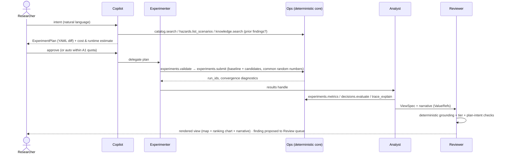
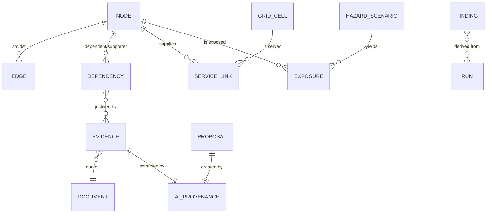
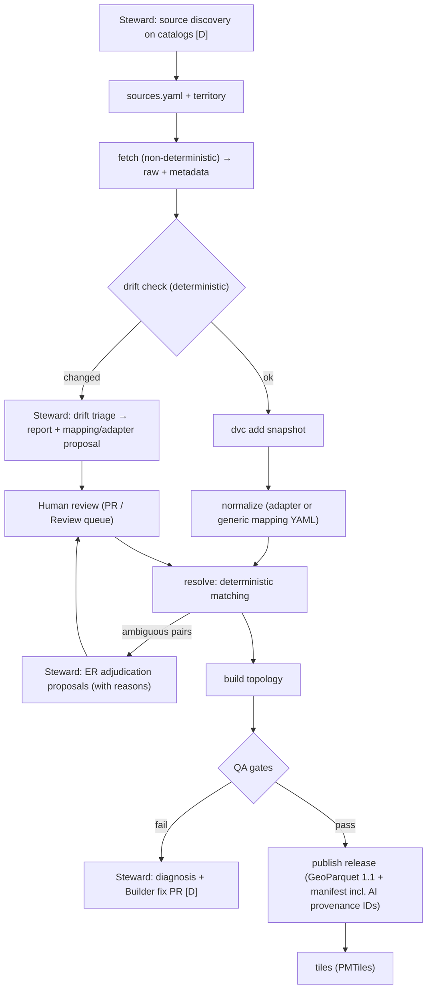
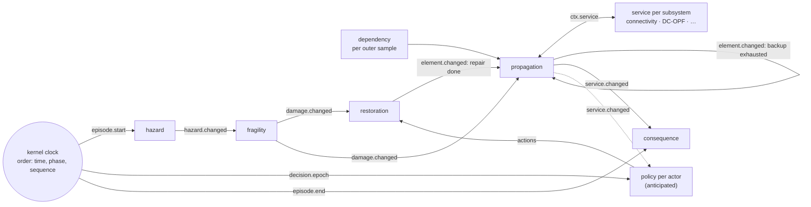
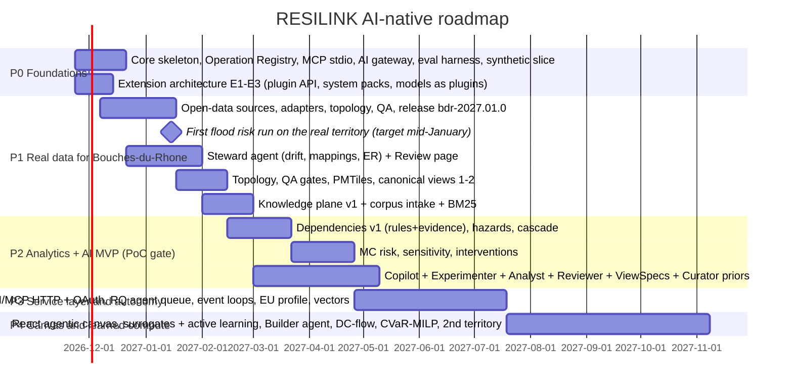

# RESILINK Digital Lab — AI-Native Technical Blueprint (v2.2)

> **Date:** v2.0 approved 2026-11-16 · **v2.2 2026-11-23** · **Pilot:** Bouches-du-Rhône (13) + buffer · **Horizon:** 12+ months · **Repository:** https://github.com/Yiping-UPSaclay/RESILINK (public; Sprint 0 implemented and verified, not yet committed)
> **Tags:** **[E]** essential now · **[D]** deferred (planned for a later phase) · **[O]** optional (adopted only if a named trigger fires)
> Claims marked ✔ were checked against official documentation or the publisher's own pages on 2026-11-16, on 2026-11-23 for F12 and the §6 additions, or on 2026-11-26 for the D1 sources (§16). **TBC** means the claim must be confirmed during implementation.
> **v2.2 changes (accepted 2026-11-23: [ADR-0008](../adr/0008-extension-architecture.md) revision 2).**
> - The core stays small: kernel, shared board, RNG, composition, reducers, provenance.
> - **System packs, slot definitions and models** are registered, versioned plugins. A new system (e.g. water), a new kind of question (e.g. crew road access) or a new operation model (e.g. DC-OPF, AC-OPF) can be added later without core edits.
> - Also new: an event-driven episode kernel with per-operator decisions; model ensembles; data-need checks; `observations` tables; persistent-worker execution; draft (0.x) contracts until real theses use them; a proving ground; and a student on-ramp.
> - v2.1 (same day) was the first revision. Changed sections: §1.1, §1.2 (architecture map), §1.4, §2, §4.4, **§6 (rewritten)**, §10.2, §11–§16.

---

## 0. Context

**Purpose.** RESILINK is a proof-of-concept digital laboratory for risk and resilience analysis of interdependent French infrastructures (electricity, gas, telecoms), built on open data. It must be modular, extensible and data-agnostic.

**Agreed technical direction:**
- GeoParquet as the canonical, versioned data format.
- DuckDB Spatial for analytics.
- A Python analytics core independent of any UI.
- A Streamlit MVP first, then FastAPI + React + MapLibre, with deck.gl where GPU rendering pays off.

**New requirement (2026-11-16): the platform must be fully AI-native.** This blueprint does not bolt a chatbot onto a classical web app. It treats the lab as a system **operated jointly by humans and AI agents**, with three structural commitments:
1. Every capability is a **typed operation** that agents and humans call through the same contract.
2. The lab maintains a **machine-readable knowledge plane** (ontology, evidence-backed assumptions, models, runs, findings) that agents reason over.
3. A **deterministic, reproducible core** remains the single source of numbers. AI proposes, the core computes, and humans approve.

### Verified facts that shape the design

| # | Fact (✔) | Consequence |
|---|---|---|
| F1 | Since the **16 June 2026** release, ODRÉ's RTE substation dataset has **no geometry fields** (`code_poste, nom_poste, fonction, etat, tension, departement`; 5,042 records). The overhead-lines dataset declares no geometry type. RTE cites "*raisons de sécurité publique*". | HV geometry comes from **OSM**. RTE tables are the attribute and completeness reference. Security tiers apply from day 1. Superseded RTE geometry is not ingested. |
| F2 | **GeoParquet 2.0.0** is released (native Parquet GEOMETRY type; 1.1 readers cannot read it). GDAL writes 2.0 only from **3.14**. GeoPandas **1.2.0** supports 2.0 but defaults to 1.1. | Write **GeoParquet 1.1** now; migrate to 2.0 only after an interoperability gate (D1). |
| F3 | **DuckDB 2.0.0 LTS** released 2026-10-21. GEOMETRY has been in core since 1.5, SPATIAL_JOIN since 1.3, and `ST_AsMVT` is available. DuckDB also ships **fts** (BM25) and **vss** (HNSW) extensions. HNSW indexes are in-memory unless experimental persistence is enabled. | One engine for spatial analytics, dynamic tiles and hybrid retrieval over the knowledge corpus. |
| F4 | **DuckLake 1.0** (April 2026) adds snapshots and time travel. **DVC** is now stewarded by lakeFS and remains open source. | DVC for data versioning [E]. DuckLake is a candidate for the multi-writer knowledge store [D]. |
| F5 | **Streamlit 1.67.0** (2026-11-05): pydeck `on_select` supports point and brush selections. **deck.gl 9.4** ships `@deck.gl/maplibre` `MapLibreOverlay` (interleaved mode) for MapLibre v4.5.1–v6. | Fixes the MVP and the React stacks. |
| F6 | **RQ** workers need `fork()` (Linux only). **Docker Desktop** needs WSL 2. | Core development is native on Windows; workers and tile tools run in containers. |
| F7 | **MCP specification 2026-07-28** makes the protocol stateless. Streamable HTTP requests carry `Mcp-Method`/`Mcp-Name` headers, tool schemas use JSON Schema 2020-12, and authorization was hardened (RFC 9207, client ID metadata documents). **Sampling is deprecated.** The official Python SDK **v2** renamed `FastMCP` to `MCPServer`, and transport options moved to `run()`. | The lab exposes its operations as an MCP server. Gateways can route and audit by operation name from headers. The design does not depend on MCP sampling. The MCP SDK is pinned and isolated in `apps/mcp`. |
| F8 | **Claude models and prices** (Anthropic API, per million tokens): `claude-opus-5-5` $4 in / $20 out (cache read $0.20); `claude-sonnet-5-5` $2 / $10; `claude-haiku-5-5` $0.10 / $0.50. Message Batches cost 50 % less. On Opus 5.5, thinking is always adaptive (control it with `effort`, default `medium`), and forced `tool_choice` `any`/`tool` returns 400 (use `auto` + `strict: true` tools). | Default model for every agent role is `claude-opus-5-5`, with effort set per role (§1.6). Tool use always runs in `auto` mode with strict schemas. |
| F9 | **Data residency:** on the first-party API, `inference_geo` accepts only `"us"` or `"global"` (no EU pin). **Vertex AI** (region `eu` or EU regions) and **Amazon Bedrock** (EU regions) serve Claude, but lack Message Batches, the Files API, Managed Agents, the MCP connector and code execution. Messages, tool use, structured outputs, prompt caching, citations and compaction (beta) are available on every platform. | **Provider-portable agent core:** runtime agents use only the portable feature subset. First-party-only features are confined to public-tier workloads (§1.6, D24). |
| F10 | **Structured outputs** (`client.messages.parse(output_format=PydanticModel)`) **cannot be combined with citations** (400). They also reject recursive schemas and require `additionalProperties: false` on every object. | Evidence extraction uses strict tool calls plus a **deterministic verbatim-quote check** rather than the citations feature. Generated views avoid free-form dicts (§1.9). |
| F11 | The **Claude Agent SDK** (self-hosted harness: custom tools via `create_sdk_mcp_server`, `PreToolUse` hooks returning allow/deny/ask, subagents) suits a coding agent. **Managed Agents** (Anthropic-hosted loop and sandbox, beta) is available only on the first-party API and Claude Platform on AWS. | The Builder agent (self-extension through pull requests) uses the Agent SDK [D]. Managed Agents is only for public-tier scheduled jobs [O]. |
| F12 | **Python entry points** are the PyPA mechanism by which an installed distribution advertises components for other code to discover. Group names are dotted identifiers; consumers are advised to prefix them with their own project name. `importlib.metadata.entry_points(group=...)` has supported selection since Python 3.10, and `EntryPoint.dist` gives the providing distribution. Prior art for model coupling: IN-CORE `BaseAnalysis.get_spec()` (declared parameters and input/output datasets); CSDMS **BMI** (`initialize`/`update`/`update_until`/`finalize`, getters and setters; C, C++, Fortran, Java, Python); **FMI 3.0.2** (Co-Simulation, Model Exchange, Scheduled Execution; an FMU is one ZIP file); **pluggy** (pytest's hook system: one hook call runs N implementations). | System packs, slot definitions, models and analysis ops are plugins in the entry-point groups `resilink.systems`, `resilink.slots`, `resilink.models` and `resilink.ops`. One selected model (or a weighted ensemble) per slot, not pluggy's N-implementation hooks. Model cards follow IN-CORE's declarative style. BMI vocabulary for lifecycle models; FMI and BMI wrappers are optional execution modes (§6, ADR-0008). |

**Local environment:** Windows 11 Pro (build 26200), Anaconda with Python 3.12.7, git 2.53. Docker, Node, uv and gh are **not** installed.

---

## 1. Target architecture (AI-native)

### 1.1 What changes compared with a traditional platform

| Concern | Traditional research platform | RESILINK AI-native lab |
|---|---|---|
| Primary interaction | Fixed screens and forms | **Intent → plan → run → grounded explanation.** An agent compiles the request into a reviewable plan (experiment config, query, view spec). The deterministic core executes it, and the answer cites the data. Fixed pages remain as *canonical views*. |
| Contract | REST endpoints written by hand per feature | One **Operation Registry** of typed operations. MCP tools, REST, CLI, UI forms and agent tools are all *generated projections* of it. |
| Knowledge | Documentation kept separately from data | A **lab knowledge graph**: ontology, data semantics, assumptions with evidence, model cards, runs, findings. Agents and humans query it, and it is versioned. |
| Model assumptions | Hard-coded or in spreadsheets | **Evidence-backed priors.** Agents extract quantified claims with verbatim quotes, humans accept them, and accepted values become priors sampled in Monte Carlo. |
| Extension | Developers write every adapter; new models, systems and model types are edited into the core | A small fixed core. **System packs, slot definitions and models** (PhD theses) are versioned plugins: discovered from installed packages, pinned per experiment and gated by a conformance kit, with **no core edit** (§6). New slots and systems follow "easy to propose, reviewed to adopt". Agents draft adapters and plugins against these contracts and open **pull requests**; humans review them. |
| Compute | Simulation only | Simulation is the ground truth. **Learned surrogates** handle interactive what-ifs and screening, with **active learning** choosing which simulations to run [D]. |
| Visualisation | Predefined dashboards | **Generative views.** Agents emit validated `ViewSpec`s bound to data references, so values come from the store, never from model text. |
| Operations | Cron jobs | **Event-driven agents** react to new snapshots, drift and weather alerts, producing briefings and proposals [D]. |
| Quality | Unit tests | Unit and property tests, plus **agent evals** (golden tasks with numeric ground truth), **grounding checks** and an adversarial (prompt-injection) suite. |

### 1.2 Architecture map (status 2026-11-25: Sprint 0 + ADR-0008 E1–E3 built)

Colours show status:
- **Green:** built and verified (Sprint 0, plus E1–E3 of ADR-0008).
- **Amber:** next in the re-ordered plan (P1 real-data track, P2 analytics and engine).
- **Grey dashed:** deferred until the first thesis needs it, or to P3–P4.

```mermaid
flowchart TB
  classDef built fill:#e3f1e8,stroke:#2e7d4f,color:#10261a
  classDef next fill:#fdf1d6,stroke:#b7791f,color:#2b1d05
  classDef deferred fill:#eef0f4,stroke:#7a8194,color:#2a2f3a,stroke-dasharray:5 3

  subgraph EXP["Experience plane"]
    direction LR
    UI["Streamlit: Copilot · Risk · Review · Ops console"]:::built
    EXTC["External MCP clients<br/>(Claude Code / Desktop)"]:::built
    WEB["React agentic canvas [P4]"]:::deferred
  end

  subgraph AG["Agent plane — packages/resilink-ai"]
    direction LR
    COP["Copilot · Reviewer<br/>(live use needs an API key)"]:::built
    GW["AI Gateway: tier routing · budgets · grounding · provenance"]:::built
    SPC["Steward [P1] · Curator · Experimenter · Analyst [P2]"]:::next
    BLD["Integration assistant [P2]"]:::deferred
  end

  subgraph CAP["Capability plane — resilink.ops"]
    direction LR
    REG["Operation Registry (18 ops)<br/>read · compute · propose · admin"]:::built
    PROJ["Projections: CLI · MCP · UI forms · agent tools"]:::built
    MOPS["Discovery ops: systems · slots · models [E9]"]:::deferred
  end

  subgraph KN["Knowledge plane — resilink.knowledge"]
    direction LR
    CUR["Curated YAML in git<br/>ontology · rules · assumptions · fragility"]:::built
    KS["DuckDB store: op calls · proposals<br/>findings · AI provenance · BM25"]:::built
    MCARD["Model cards in the knowledge graph [E9]"]:::deferred
  end

  subgraph ENG["Engine — the small fixed core (ADR-0008)"]
    direction LR
    MREG["Registries + system catalog<br/>entry points · policy · pinning"]:::built
    CMP["Composer<br/>config schema 2 · version pinning"]:::built
    ORC["episode 0.1 orchestrator<br/>+ nested_mc sampler"]:::built
    KER["Event kernel, episode 0.2 [E4, P2]<br/>decision epochs · per-slot RNG"]:::next
    CHK["Data-need check · defaults report<br/>ensembles [E5b, P2]"]:::next
    RED["Reducers<br/>bands · VaR/CVaR · EAL"]:::built
  end

  subgraph EXTN["Registered extensions — versioned, 0.x draft until proven"]
    direction LR
    SYS["System packs<br/>elec · facility · gas · telecom"]:::built
    SLT["Slot definitions v0.1<br/>7 model slots + orchestrator + sampler"]:::built
    MOD["Built-in models as plugins (10)<br/>import only plugin_api"]:::built
    ANT["Anticipated slots: degradation<br/>resources · policy · lifecycle"]:::deferred
    THS["Thesis plugins · new systems<br/>(packages in plugins/)"]:::deferred
  end

  subgraph RUN["Execution and quality"]
    direction LR
    EXM["In-process execution"]:::built
    WRK["Persistent worker · batch<br/>FMI/BMI [E7]"]:::deferred
    KIT["Conformance kit · sandbox<br/>function plugs [E8]"]:::deferred
    BEN["Proving ground:<br/>observed events [P1e]"]:::next
  end

  subgraph SUB["Data substrate"]
    direction LR
    SRC["Connectors + drift gate<br/>ODRÉ · Enedis (5 sources)"]:::built
    ADP["More sources · adapters · entity matching<br/>topology · QA [D1–D6, P1]"]:::next
    REL["Immutable releases<br/>synthetic today · bdr-2027.01.0 next"]:::built
    OBS["observations tables [E6, P2]"]:::next
    RES["Results store + run manifests<br/>models pinned per run"]:::built
  end

  GOV["Governance: tiers · autonomy · quotas · budgets · evals · invariants I1–I7 · plugin import contract"]:::built

  UI --> COP
  UI --> PROJ
  EXTC --> PROJ
  COP --> GW
  COP --> REG
  PROJ --> REG
  REG --> KS
  REG --> CMP
  MOPS -.-> MREG
  MREG --> CMP
  CMP --> ORC
  ORC -->|calls| MOD
  KER -.->|generalises| ORC
  SYS -.->|systems| MREG
  SLT -.->|contracts| MOD
  THS -.->|plug into| SLT
  MOD -.->|runs via| EXM
  KIT -.->|gates| THS
  BEN -.->|scores| MOD
  SRC --> ADP
  ADP --> REL
  REL --> ORC
  OBS -.-> ORC
  ORC --> RES
  RES --> RED
  GOV -.- AG
  GOV -.- CAP
```



**How to read the map.**
- **The shell is in place.** The AI-native shell from v2.0 (experience, agents, capabilities, knowledge) is built. The Copilot is tested with scripted responses only, until an API key is available (decision D-APIKEY).
- **The core is now plugin-based.** The engine composes registered system packs, slot definitions and models chosen by the experiment configuration. Each run pins the exact code, so results stay comparable and traceable. The built-in models import only the plugin API, which an architecture rule enforces.
- **The next work is real data** (amber, bottom row). The connectors exist, but the adapters, entity matching, topology build and QA that produce the Bouches-du-Rhône release `bdr-2027.01.0` do not yet. A first flood risk run on it is targeted for mid-January (roadmap D7, proof-of-concept criterion POC/AC2).
- **Theses plug in at the extensions row** without touching the planes above. The tooling that makes that easy (conformance kit, examples, discovery ops) waits until the first thesis needs it.

### 1.3 Invariants

Each invariant is enforced by code, a test or an eval.

| ID | Invariant | Enforcement |
|---|---|---|
| **I1** | **The deterministic core is the only source of numbers.** AI produces *artifacts* (configs, mappings, priors, specs, code), never canonical values. Every number shown to a user resolves to a stored result or a recorded op output (`ValueRef`). | ViewSpec renderer reads values only via `ValueRef`; grounding checker (§1.9); eval suite |
| **I2** | **Proposals, not mutations.** Agent side effects are limited to `read`, `compute` (quota-bounded) and `propose`. Changes to canonical data, configs or code take effect only after **human approval** (git PR or Review queue), followed by deterministic re-execution. | Op side-effect classes + policy engine; `admin` ops are human-only |
| **I3** | **Reproducibility without re-prompting.** AI outputs are frozen as versioned artifacts with provenance. `dvc repro` and `resilink reproduce` never call an LLM. | CI test runs the pipeline with the network blocked for LLM endpoints |
| **I4** | **Tier-aware AI routing.** The data tier decides which model endpoint may see the data. `restricted` data is never sent to an external LLM by default. | Gateway refuses; adversarial eval |
| **I5** | **Untrusted-text quarantine.** External text (documents, dataset descriptions, OSM tags, web pages) is data, not instructions. Agents that read it get no `compute`/`propose` tools in the same context, and their outputs must pass schema validation. | Role tool allow-lists; injection eval suite |
| **I6** | **Full AI provenance.** Every AI artifact records role, provider, model, effort, prompt hash, tool calls (input/output hashes), usage, cost and the approving human. | `ai_provenance` table; release manifests embed provenance IDs |
| **I7** | **Capability parity and graceful degradation.** Everything an agent can do, a human can do through the CLI or UI (same ops), and the lab is fully usable with AI switched off. | Projections are generated from one registry; CI job with `RESILINK_AI=off` |
| R1–R5 | Immutable releases · hexagonal core (the core imports **no** UI, web, queue or LLM SDK) · exposure contract (simulations never touch geometry) · results keyed by stable ID · sensitivity tiers | import-linter, hashes, tests (see §2, §4) |

### 1.4 Component responsibilities

| Component | Responsibility | Must NOT | Tag |
|---|---|---|---|
| `resilink.domain` | Types, vocabularies, ID grammar, pandera schemas, config models | Perform I/O | [E] |
| `resilink.io` | Release catalog, GeoParquet I/O, DuckDB sessions, results store | Contain domain logic | [E] |
| `resilink.etl` | Connectors, adapters, entity resolution, topology build, QA, publish, tiles | Be imported by analysis modules | [E] |
| **`resilink.plugin_api`** (v2.2) | **Public contract for extensions (0.x draft → 1.0 after two theses):** `ModelCard`, `SlotDefinition`, system-pack schema, board fields, events, contexts, data needs, execution modes, function-plug decorators. The only core module plugins may import. | Import anything above `domain`; change without re-certifying registered plugs | **[E]** |
| **`resilink.registry`** (v2.2, E1–E2) | Registries for systems, slots and models (entry points, policy, pinning) and the **system catalog**. It sits just above `io` because network compilation, the synthetic territory and ETL checks need it | Contain model logic | **[E]** |
| **`resilink.engine`** (v2.2) | The small fixed core: composer (data needs, defaults report, ensembles); event kernel and shared board; RNG streams; samplers (`nested_mc`); execution runners (in-process, worker); weighted reducers; conformance kit and impact report | Name a specific system or model; contain model logic | **[E]** |
| `resilink.systems` · `resilink.slots` (v2.2) | Built-in system packs (`elec`, `facility`, `gas`, `telecom`, as YAML files, replacing the constants in `domain/vocab.py`) and the seven built-in slot definitions, registered through the core's own entry points | Be special-cased by the engine | [E] |
| `resilink.spatial` · `network` · `dependencies` · `hazards` · `fragility` · `cascade` · `risk` · `decisions` · `experiments` | Deterministic analytics (§6). From v2.2, models in these modules are **built-in plugins** registered like external ones. | Import LLM or UI code; be called by the engine except through the registry | [E] |
| `resilink.sandbox` (v2.2) | Notebook API for trying a model on the synthetic territory before packaging it | Write releases or canonical results | [E] |
| `plugins/*` · `examples/plugins/*` (v2.2) | Research plugins (models, draft slots, system packs) as workspace members under incubation; the examples `resilink-example-ageing` (new slot) and `resilink-example-water` (new system); mature plugins may live in pinned repositories | Import core internals other than `resilink.plugin_api`; call LLMs or the network | [E] |
| `benchmarks/` (v2.2) | Proving ground: observed events, truth from `observations`, scoring rules, leaderboards per slot | Change ensemble weights or maturity without human approval | [D, P1–P2] |
| **`resilink.ops`** | **Operation Registry**: typed op specs (input/output pydantic models, side-effect class, minimum tier, cost hint, LLM-facing description) plus thin facades over the core | Hold business logic beyond orchestration | **[E]** |
| **`resilink.knowledge`** | Knowledge-graph schemas and stores (entities, relations, documents, evidence, proposals, findings, provenance), BM25 index, `ValueRef` resolution | Call LLMs | **[E]** |
| **`resilink-ai`** (separate package) | AI Gateway, agent roles, tool projection, grounding checker, ViewSpec models, retrieval orchestration, evals runner | Write canonical data directly (I2) | **[E]** |
| `apps/mcp` | MCP server projection of the registry (stdio in P0, Streamable HTTP + OAuth in P3) | Bypass policy | [E] |
| `apps/streamlit` | Copilot chat, Review queue, canonical views | Contain analytics code | [E] |
| `apps/api` · `apps/worker` | REST projection, Copilot sessions (SSE), job queue (runs, agents, ETL) | Run heavy compute in-process | [D] |
| `apps/web` | React agentic canvas (chat + MapLibre/deck.gl + Vega-Lite views + approvals) | Query DuckDB directly | [D] |
| `apps/builder` | Claude Agent SDK coding agent that drafts adapters/plugins as PRs in a sandbox | Push to the main branch | [D] |

### 1.5 Capability plane: the Operation Registry [E]

Each op is defined once. MCP tools, REST routes, CLI commands, Streamlit forms and agent tool definitions are all generated from it.

```python
# packages/resilink/src/resilink/ops/registry.py   (core: no LLM / web imports)
class SideEffect(StrEnum):
    READ = "read"; COMPUTE = "compute"; PROPOSE = "propose"; ADMIN = "admin"   # ADMIN = humans only

@dataclass(frozen=True)
class OpSpec:
    name: str                          # "network.dependencies_of"
    summary: str                       # LLM- and human-facing; states WHEN to call it
    input_model: type[BaseModel]       # pydantic v2 → JSON Schema 2020-12 (matches MCP 2026-07-28 ✔)
    output_model: type[BaseModel]
    side_effect: SideEffect
    min_tier: Tier                     # highest data tier the op can expose
    cost_hint: Literal["ms", "s", "min", "h"]
    fn: Callable[[BaseModel, "OpContext"], BaseModel]

@op("network.dependencies_of", side_effect=SideEffect.READ, min_tier="internal", cost_hint="ms",
    summary="Return the upstream (supporters) or downstream (dependents) subgraph of an asset up to `depth`, "
            "with probabilities from a named dependency model. Call when the user asks what an asset relies on "
            "or what would be affected if it failed.")
def dependencies_of(inp: DependenciesOfInput, ctx: OpContext) -> DependencySubgraph: ...
```

**Initial op catalogue (≈ 30 ops)**, grouped by side-effect class:
- **read**
  - `catalog.list_releases`, `catalog.describe_table` (column semantics and units from `layers.yaml`), `catalog.search`
  - `data.features` (bbox, filter, capped), `data.get_asset`, `data.aggregate`
  - `network.dependencies_of`, `network.path_to_source`
  - `hazards.list_scenarios`, `hazards.exposure_summary`
  - `experiments.status`, `experiments.metrics`, `experiments.trace_explain` (a deterministic causal chain built from cascade cause codes)
  - `knowledge.search`, `knowledge.get`
  - `etl.describe_source`, `etl.drift_report`
  - `proposals.list`
- **compute**
  - `experiments.validate`, `experiments.submit` (quota-checked)
  - `decisions.evaluate` (common random numbers)
  - `views.render_check`
- **propose**
  - `mappings.propose`, `er.propose_match`
  - `evidence.propose`, `priors.propose`, `dependency_rules.propose`
  - `findings.propose`, `views.save`
- **admin** (humans only)
  - `proposals.approve` / `reject`, `releases.publish`, `policies.update`

**Self-describing data.** Every column in `configs/layers.yaml` carries a `description`, `unit` and `semantics`. `catalog.describe_table` serves these, so agents never guess column meanings.

### 1.6 Agent plane [E]

**Autonomy levels:**
- **A0** read.
- **A1** compute within quota.
- **A2** propose (takes effect only after approval).
- **A3** commit canonical changes: **humans or CI after approval only**.

| Role | Purpose | Tools (op allow-list) | Max autonomy | Default model / effort (`configs/ai/models.yaml`) |
|---|---|---|---|---|
| **Copilot** (orchestrator) | Turns user intent into a plan (`ExperimentPlan`, `QueryPlan`, `ViewSpec`), shows plan + cost estimate, delegates to specialists, answers with grounded numbers | All `read`, `experiments.validate/submit`, `views.*`, delegate-to-role | A1 (A2 via specialists) | `claude-opus-5-5` / `medium` |
| **Data Steward** | Source discovery, drift triage, adapter mapping drafts, entity-resolution adjudication, QA-failure diagnosis | `catalog.*`, `etl.*`, `mappings.propose`, `er.propose_match` | A2 | `claude-opus-5-5` / `medium` |
| **Evidence Curator** | Reads the corpus (quarantined, I5) and extracts quantified evidence with verbatim quotes, for example mobile-site battery autonomy or substation flood thresholds | `knowledge.search`, `docs.read_page`, `evidence.propose` **only** | A2 | `claude-opus-5-5` / `high` |
| **Experimenter** | Designs scenario sets and sensitivity analyses (Morris/Sobol), submits runs, checks convergence, compares dependency models | `experiments.*`, `decisions.evaluate`, `hazards.*` | A1 | `claude-opus-5-5` / `high` |
| **Analyst** | Grounded explanations, cascade narratives from `trace_explain`, `ViewSpec`s, report sections, finding proposals | `experiments.metrics/trace_explain`, `data.aggregate`, `views.*`, `findings.propose` | A2 | `claude-opus-5-5` / `medium` |
| **Reviewer** | Checks other agents' outputs before they reach humans: numbers grounded, quotes verified, tier respected, plan matches intent | Read-only + `grounding.check` | A0 | `claude-opus-5-5` / `high` |
| **Builder** [D] | Drafts new adapters, ops and plugins with tests in a sandboxed checkout, then opens a PR | Claude Agent SDK built-ins, with hooks that deny writes outside `etl/adapters/**`, `configs/**`, `tests/**` | A2 (PR) | `claude-opus-5-5` / `high` |

All roles default to Opus 5.5. A cheaper model for a role (for example Haiku 5.5 for high-volume entity-resolution adjudication) is a **user decision** taken only after that role's eval shows quality holds.

**Harness choices (provider-portable):**
- **Runtime agents (Copilot through Reviewer) [E]:** Anthropic Python SDK (`anthropic`), Messages API with tool use.
  - The SDK tool runner (beta) is the default loop. Validation, authorization and provenance run inside the tool functions; a manual loop is the fallback.
  - Only portable features are used (tool use, structured outputs, prompt caching, compaction beta), so the same code runs on the Anthropic API, Vertex AI (EU) or Bedrock (EU) (F9).
- **Builder [D]:** Claude Agent SDK (`ClaudeSDKClient`, `create_sdk_mcp_server` for RESILINK ops, `PreToolUse` hooks for path and command policy) or Claude Code in CI.
- **Managed Agents [O]:** only for public-tier scheduled jobs, for example nightly catalog discovery on data.gouv.fr. The geo pin is US/global only.
- **External MCP clients [E]:** Claude Code in VS Code can operate the lab from day 1 through the stdio MCP server, e.g. `claude mcp add resilink -- uv run resilink-mcp`.

**AI Gateway (sketch; the semantics are what matter, and the loop runs inside the tool runner):**

```python
# packages/resilink-ai/src/resilink_ai/gateway.py
import anthropic
from pydantic import ValidationError
from resilink.ops import REGISTRY, OpContext
from resilink_ai.policy import POLICY, PolicyDenied
from resilink_ai.provenance import PROVENANCE

def tool_defs(role) -> list[dict]:
    """Deterministic, sorted → cache-stable prefix (tools render before system)."""
    return [{"name": s.tool_name,                          # "network__dependencies_of" (no dots in tool names)
             "description": s.summary,
             "input_schema": s.input_json_schema,           # additionalProperties: false everywhere
             "strict": True}
            for s in sorted(REGISTRY.for_role(role), key=lambda s: s.name)]

def client_for(session):
    prof = POLICY.provider_for(session.tier)               # restricted → PolicyDenied (I4)
    if prof.kind == "vertex":
        return anthropic.AnthropicVertex(project_id=prof.project_id, region=prof.region)   # e.g. region="eu"
    return anthropic.Anthropic()                            # env key or `ant auth login` profile

def request(session):
    kw = dict(model=session.role.model, max_tokens=16000,
              system=[{"type": "text", "text": session.role.system_prompt, "cache_control": {"type": "ephemeral"}}],
              tools=tool_defs(session.role), messages=session.messages,
              thinking={"type": "adaptive"}, output_config={"effort": session.role.effort})
    client = client_for(session)
    if isinstance(client, anthropic.Anthropic):            # first-party: server-side refusal fallback (enabled by default)
        return client.beta.messages.create(betas=["server-side-fallback-2026-07-01"], fallbacks="default", **kw)
    return client.messages.create(**kw)                    # Vertex/Bedrock: SDK BetaRefusalFallbackMiddleware (TBC)

def run_tool(block, session) -> dict:                       # called for EVERY tool_use block; all results returned in one user turn
    spec = REGISTRY.by_tool_name(block.name)
    try:
        inp = spec.input_model.model_validate(block.input)  # validate before executing
        POLICY.authorize(session, spec)                      # tier, autonomy, quota, budget
        out = spec.fn(inp, OpContext.for_session(session))
        call = PROVENANCE.record_call(session, spec, inp, out)   # input/output hashes → ValueRef target
        return {"type": "tool_result", "tool_use_id": block.id, "content": f"{out.model_dump_json()}\n[call_id={call.id}]"}
    except (ValidationError, PolicyDenied) as e:
        return {"type": "tool_result", "tool_use_id": block.id, "is_error": True, "content": str(e)}
# stop_reason handling: "refusal" → never run that turn's tools; "max_tokens" with tool_use → retry larger;
# "end_turn" → grounding check (§1.9) before the answer is shown.
```

**Prompt caching layout:**
- Frozen role system prompts are versioned in `prompts/` and hashed into provenance.
- The tool list is sorted and deterministic.
- Volatile context (timestamps, the current selection) goes in messages, never in `system`.
- Mid-session mode switches use mid-conversation system messages, which preserve the cached prefix.

**Budgets:** usage is accumulated from `response.usage` per session, role and day. Hard caps live in `configs/ai/policies.yaml`.

### 1.7 Knowledge plane [E]

**Two stores with different roles:**
- **Curated knowledge in git** (`knowledge/`) is human-approved and diffable:
  - `ontology.yaml` (asset classes, dependency mechanisms, hazard and intensity types)
  - `dependency_rules.yaml` (compatibility matrix and priors, each rule linked to evidence IDs)
  - `evidence/accepted/*.yaml`, plus `assumptions.yaml` (generated from accepted evidence + rationale)

  **Git is the approval ledger:** agent proposals become branches or PRs (or Review-queue items that a human exports to a PR).
- **Machine knowledge in DuckDB** (`data/knowledge/knowledge.duckdb`) holds bulk and append-only data:
  - documents and chunks, with a BM25 index ✔ [E] and HNSW vectors ✔ [D]
  - proposals, findings, AI provenance and graph edges

  It moves to DuckLake 1.0 when several writers are needed [D].

**Evidence pipeline (assumptions with sources):**
1. **Corpus intake.** A curated list of documents: regulations and reports (ARCEP, ANFR, ministries), operators' public reports, post-event reviews (e.g. Storm Alex), open-access papers, damage-function manuals. Each document carries licence, tier and SHA-256, and is chunked by page.
2. **Extraction.** The Curator reads pages and calls `evidence.propose(quantity, value|low|high, unit, conditions, doc_id, page, quote)`. The harness **verifies the quote verbatim** against the stored page text (normalised whitespace) and rejects non-matching quotes. This is deterministic and portable across providers (F10).
3. **Review.** Humans accept or reject in the Review queue. Accepted evidence is aggregated into a prior (e.g. fitting a lognormal to several reported backup autonomies, with weights by source quality). A PR to `assumptions.yaml` carries the links back to the evidence.
4. **Bulk mode [D].** For public-tier corpora, Message Batches (−50 %, first-party API only) can be used.

**Knowledge-driven model structure.** Dependency mechanisms come from `dependency_rules.yaml`, whose rules are proposed with evidence. For example, an LNG terminal → power supply rule records which loads depend on the grid and whether a backup exists. A quantitative dependency model (§6.4) then turns the rules into probabilistic edges. ML link prediction is a later plugin [D].

**Lab memory.** Findings are claims plus `ValueRef`s plus run and release IDs. Findings tied to a superseded release are marked `stale`. The Copilot retrieves past findings before proposing new runs, which avoids repeating work.

**Retrieval.** In P1–P2, agentic search over the structured catalog plus BM25 over the corpus is enough. Vector search is added in P3 using a **local multilingual open-weight embedding model**, chosen by a small French/English retrieval eval; no embeddings are sent to external services. Hybrid ranking uses reciprocal-rank fusion.

### 1.8 Learned compute: surrogates and active learning [D, P4]

```python
class SurrogateModel(Protocol):
    surrogate_id: str; trained_on_runs: tuple[str, ...]
    def predict(self, net: CompiledNetwork, exposure: ExposureBatch, interventions: InterventionSet) -> SurrogatePrediction: ...
        # per-node P(down), per-cell P(disruption), loss — each with a predictive interval
```

**Progression:**
1. A gradient-boosting baseline on node and cell features (fast, interpretable).
2. A heterogeneous GNN over the multilayer graph (library TBC at P4).

**Uses:**
- Interactive what-ifs in the UI (< 100 ms).
- Screening of intervention portfolios before simulation.
- **Active learning:** queue simulator runs where predictive uncertainty or decision impact is highest, then retrain.

**Rule (extends I1):** surrogate outputs are labelled *screening*. Any number in a report or decision is **re-simulated**.

**Acceptance:**
- Calibrated intervals: 90 % interval coverage of 85–95 % on held-out simulations.
- Ranking agreement (Kendall τ ≥ 0.8) on intervention screening.

### 1.9 Generative UI with guaranteed grounding [E, P2]

```python
class ValueRef(BaseModel):                         # the only way a view can show a number
    run_id: str | None = None
    call_id: str | None = None                     # a recorded op output (I6)
    table: Literal["metrics", "cell_stats", "node_stats", "sample_losses", "exposure"] | None = None
    column: str | None = None
    filters: list[Filter] = []
    agg: Literal["none", "sum", "mean", "p50", "p95"] = "none"

class MapLayerSpec(BaseModel):
    layer_id: str                                  # must exist in layers.yaml and be allowed for the viewer's tier
    color_by: ValueRef | None = None
    filter_json: str | None = None                 # MapLibre filter subset, validated server-side

class ChartSpec(BaseModel):
    vega_lite_json: str                            # constrained Vega-Lite as a JSON string (structured outputs forbid free dicts, F10)
    data: list[NamedValueRef]                      # renderer injects values; inline data is rejected

class ViewSpec(BaseModel):
    title: str; narrative_md: str
    map_layers: list[MapLayerSpec] = []; charts: list[ChartSpec] = []
    provenance_id: str
```

**Pipeline:**
1. The agent produces a `ViewSpec` via `client.messages.parse(output_format=ViewSpec)`.
2. A validator checks layer IDs, tier, Vega-Lite subset, `ValueRef` resolvability and size caps.
3. The **grounding checker**: every numeric token in `narrative_md` must equal (after rounding) a value resolved from the session's `ValueRef`s or recorded tool outputs, or carry an explicit non-data mark such as a year. This check is deterministic. The Reviewer agent then checks semantic consistency.
4. A renderer draws the view: Streamlit (pydeck + Altair) now, React (MapLibre/deck.gl + Vega-Lite) later.

Saved views are versioned artifacts that can be shared.

### 1.10 Event-driven agent loops [D, P3]

| Trigger | Agent action (≤ A2) | Output |
|---|---|---|
| New raw snapshot fetched | Steward: drift triage | Drift report + proposal (e.g. adapter mapping update) |
| QA gate failure | Steward: diagnosis | Ranked hypotheses + suggested fix PR (Builder) |
| Hub'Eau level above threshold / FWI above threshold | Experimenter runs a **pre-approved nowcast template** within quota; Analyst writes a briefing | Briefing `ViewSpec` + notification |
| New release published | Analyst re-checks findings | Stale-findings list + re-run proposals |

**End-to-end example.** User intent: "Which 10 mobile sites in Marseille most need 8-hour batteries under the TRI medium flood?"



---

## 2. Repository structure (uv workspace monorepo)

```
RESILINK/
├─ pyproject.toml · uv.lock · .importlinter · dvc.yaml · dvc.lock
├─ CLAUDE.md                       # invariants, commands, conventions for AI contributors [E]
├─ .claude/skills/                 # project skills: add-source, add-op, add-model-plugin, run-evals [E]
├─ docker/ compose.yaml · core.Dockerfile · tippecanoe.Dockerfile · martin/config.yaml · caddy/Caddyfile
├─ configs/
│  ├─ territories/ · sources.yaml · layers.yaml (incl. column semantics) · fragility/ · imports/ · experiments/
│  ├─ plugins.yaml                 # v2.2: enabled systems/slots/models, maturity policy per territory kind, licence allow-list
│  └─ ai/ models.yaml (roles → model, effort) · policies.yaml (tiers → providers, autonomy, quotas, budgets)
├─ knowledge/                      # curated, git-approved: ontology.yaml (incl. standard state fields) · dependency_rules.yaml · evidence/accepted/ · assumptions.yaml
├─ prompts/                        # versioned role system prompts (hash recorded in provenance)
├─ packages/
│  ├─ resilink/                    # deterministic core (NO llm/ui/web imports)
│  │  └─ src/resilink/{domain,plugin_api,io,etl,spatial,network,systems,slots,dependencies,hazards,fragility,cascade,restoration,consequence,risk,engine,sandbox,decisions,experiments,ops,knowledge,cli}/
│  └─ resilink-ai/                 # AI layer: depends on resilink + anthropic
│     └─ src/resilink_ai/{gateway,policy,provenance,grounding,viewspec,retrieval,agents/{copilot,steward,curator,experimenter,analyst,reviewer}}/
├─ plugins/                        # v2.2: research plugins under incubation (workspace members; CODEOWNERS = student + supervisor)
│  └─ <name>/ pyproject.toml (entry points) · src/<pkg>/ · tests/ · MODEL_CARD.md · conformance report
├─ examples/plugins/               # v2.2: resilink-example-ageing (draft slot `degradation` + models) · resilink-example-water (new system)
├─ benchmarks/                     # v2.2 [D, P1–P2]: proving ground (benchmark.yaml per observed event)
├─ docs/extensions/                # v2.2: one-page extension proposals for new slots and system packs
├─ apps/ streamlit/ · mcp/ · api/ [D] · worker/ [D] · web/ [D] · builder/ [D]
├─ evals/ golden/ (synthetic-territory tasks with numeric truth) · adversarial/ (injection, tier leaks) · extraction/ (labelled docs) · runner.py · reports/
├─ tests/ unit · property · integration · contract · regression · perf
├─ docs/ architecture/blueprint.md · adr/ · data-catalog/ (generated) · model-cards/
└─ data/ (git-ignored, DVC) raw/ · staging/ · releases/ · tiles/ · results/ · knowledge/
```

**Import-linter contracts [E]:**
- Layering inside `resilink`.
  - Sprint 0, as implemented: `cli > ops > views > experiments > risk > cascade > fragility|dependencies|hazards > network > synthetic|knowledge|etl > io > domain`.
  - v2.2 target: `cli > ops > views > experiments > sandbox > engine > risk > cascade|restoration|consequence > fragility|dependencies|hazards > network > synthetic|knowledge|etl > registry > io > systems|slots > plugin_api > domain` (implemented after E2 without the layers of later steps).
  - The engine reaches systems, slots and models **only through the registries** (entry points), never by static import.
- Forbidden imports for `resilink`: `streamlit`, `pydeck`, `fastapi`, `starlette`, `rq`, **`anthropic`, `mcp`, `claude_agent_sdk`**.
- `resilink_ai` must not import `resilink.io` write paths. It goes through ops only.
- **v2.2 plugin contracts:**
  - Built-in model modules and every package under `plugins/` and `examples/plugins/` may import from the core only `resilink.plugin_api`.
  - They may not import UI, LLM or HTTP client libraries.
  - The conformance kit generates the same contract for external plugins.

---

## 3. Docker Compose and local development

### 3.1 Local development (native Windows) [E]

1. Install `uv`, then run `uv sync`. Main commands: `uv run pytest`, `uv run resilink …`, `uv run streamlit run apps/streamlit/Home.py`.
2. **AI credentials:**
   - Locally, the SDK resolves `ANTHROPIC_API_KEY` or an `ant auth login` profile, so keys never go in files.
   - Vertex AI uses Google Application Default Credentials.
   - `RESILINK_AI=off` runs the lab without AI (I7).
3. **MCP in Claude Code:** `claude mcp add resilink -- uv run resilink-mcp` (stdio), giving read and compute ops on the local release.
4. **Docker Desktop (WSL 2)** runs `martin` and `tippecanoe` in P1, and the service stack from P3. Requirements ✔: WSL ≥ 2.1.5, Windows 11 Pro 23H2+, 8 GB RAM.

### 3.2 Compose services

| Service | Image | Profile | Phase | Purpose |
|---|---|---|---|---|
| `martin` | `ghcr.io/maplibre/martin:<pinned>` | `tiles` | **[E] P1** | PMTiles → MVT + TileJSON ✔ |
| `tippecanoe` | built from felt/tippecanoe tag | `tools` | **[E] P1** | Build PMTiles (`-o *.pmtiles` ✔) |
| `app` | `core.Dockerfile` target `streamlit` | `app` | [E] P2 | Streamlit (Copilot + views) |
| `mcp` | `core.Dockerfile` target `mcp` | `api` | [D] P3 | MCP Streamable HTTP behind Caddy + OAuth |
| `api` | target `api` | `api` | [D] P3 | FastAPI projection + Copilot SSE sessions |
| `worker` | target `worker` | `api` | [D] P3 | RQ queues `sim`, `etl`, `stream`, **`agent`** (event-driven loops, batch extraction) |
| `valkey` | `valkey/valkey:<pinned>` | `api` | [D] P3 | Broker (BSD-3 ✔) |
| `caddy` | `caddy:<pinned>` | `api` | [D] P3 | TLS, reverse proxy, static web/PMTiles, rate limiting; can route and audit MCP by `Mcp-Method`/`Mcp-Name` headers (F7) |
| `minio` · `postgis` · `titiler` | pinned | `s3` · `postgis` · `raster` | [O] | Only when the §3.4 triggers fire |

### 3.3 `docker/compose.yaml` (excerpt)

```yaml
name: resilink
x-core: &core
  build: { context: .., dockerfile: docker/core.Dockerfile }
  env_file: ../.env                      # ANTHROPIC_API_KEY / GOOGLE_APPLICATION_CREDENTIALS, never committed
  volumes: [ "${RESILINK_DATA:-../data}:/data" ]
services:
  martin:
    image: ghcr.io/maplibre/martin:${MARTIN_TAG}
    profiles: ["tiles"]
    command: ["--config", "/config/config.yaml"]
    volumes: [ "./martin:/config:ro", "${RESILINK_DATA:-../data}/tiles:/tiles:ro" ]
    ports: ["3000:3000"]
  tippecanoe:
    build: { context: ., dockerfile: tippecanoe.Dockerfile, args: { TIPPECANOE_TAG: "${TIPPECANOE_TAG}" } }
    profiles: ["tools"]
    volumes: [ "${RESILINK_DATA:-../data}:/data" ]
  app:     { <<: *core, build: { context: .., dockerfile: docker/core.Dockerfile, target: streamlit }, profiles: ["app"], ports: ["8501:8501"] }
  valkey:  { image: "valkey/valkey:${VALKEY_TAG}", profiles: ["api"], command: ["valkey-server", "--appendonly", "yes"], volumes: ["valkey:/data"] }
  api:     { <<: *core, build: { context: .., dockerfile: docker/core.Dockerfile, target: api }, profiles: ["api"], depends_on: [valkey, martin] }
  mcp:     { <<: *core, build: { context: .., dockerfile: docker/core.Dockerfile, target: mcp }, profiles: ["api"] }
  worker:
    <<: *core
    build: { context: .., dockerfile: docker/core.Dockerfile, target: worker }
    profiles: ["api"]
    command: ["rq", "worker", "sim", "etl", "stream", "agent", "--url", "redis://valkey:6379/0"]
    deploy: { replicas: 2 }
volumes: { valkey: {} }
```

**`core.Dockerfile`** follows the official uv multi-stage pattern ✔:
1. `uv sync --frozen --no-install-workspace`, then `uv sync --locked --no-editable`.
2. Copy only `.venv` into a `python:3.12-slim` runtime.
3. Pre-run `INSTALL spatial; INSTALL fts; INSTALL vss` so containers never download DuckDB extensions at runtime.
4. Targets: `streamlit`, `api`, `mcp`, `worker`.

**`martin/config.yaml`:** `pmtiles: { paths: [/tiles] }`. Tileset stems carry the release ID, e.g. `bdr-2027.01.0__elec_mv.pmtiles`.

### 3.4 When to add PostGIS (GeoParquet stays the source of truth; PostGIS would be a serving replica)

| Trigger | Why PostGIS then | Try first |
|---|---|---|
| T1 Concurrent multi-writer curation | ACID transactions | DuckLake 1.0 with a Postgres catalog [O] |
| T2 Per-partner isolation of restricted operator data | Row-level security | Separate restricted releases and buckets |
| T3 High-rate dynamic tiles over changing data | `ST_AsMVT` + Martin functions | DuckDB `ST_AsMVT` endpoint (F3), benchmarked |
| T4 Network routing (restoration crews) | pgRouting | igraph on extracted road graphs |
| T5 Transactional standards services | pg_featureserv / tipg | Our OGC API Features read endpoints |

**Acceptance (§3):**
- `--profile tiles` serves TileJSON.
- Native `uv run pytest` passes on Windows.
- The `RESILINK_AI=off` job passes.
- Claude Code can call `catalog.list_releases` through the MCP server.

---

## 4. Data schemas and conventions

### 4.1 CRS [E]

| Use | CRS |
|---|---|
| Canonical storage and metric computation (metropolitan France) | **EPSG:2154** (Lambert-93; native CRS of Enedis HTA ✔). Territory config sets `crs_metric` for overseas. |
| Analysis lattice | **INSEE 200 m grid, EPSG:3035**, with INSEE cell IDs. An ID gives the cell's south-west corner (✔ 2026-11-26 on all 2,298,582 metropolitan cells against their 1 km parent IDs). Assets map to cells by floor division. |
| Tiles | EPSG:3857 via tippecanoe, from EPSG:4326 exported with `ST_Transform(..., always_xy := true)` |
| API GeoJSON | EPSG:4326, RFC 7946, 6 decimals |

### 4.2 Stable entity IDs (`rid`) [E]

Grammar: `rid := <layer>.<class>:<ns>:<key>`.

| Entity | Example `rid` | Key source |
|---|---|---|
| RTE substation | `elec.sub_tx:rte:<code_poste>` | Native code ✔ |
| HTA/BT substation | `elec.sub_mv_lv:fp:p895123_6245678` | 1 m coordinate fingerprint |
| Contracted HTA edge | `elec.line_mv:fp:<sha1[:12]>` | Class + sorted endpoints + length rounded to 10 m |
| Mobile station | `telecom.site:anfr:<10-char id>:<op>` | ANFR ID in the ARCEP file ✔ |
| Grid cell | `grid.cell200:insee:CRS3035RES200mN…E…` | INSEE |
| Commune | `admin.commune:cog2025:13055` | COG code with vintage |
| OSM feature | `…:osm:w123` | OSM ID + crosswalk |

**Persistence across releases:** match by native key, then fingerprint, then spatial match within the class tolerance (points 25 m, NaTran 250 m). A match carries the `rid` forward. `lineage` records `created|carried|moved|merged|split|retired`, and retired rids are never reused.

### 4.3 Release layout and writer conventions [E]

```
data/releases/bdr/2027.01.0/
  release.json · admin_areas*.parquet · grid_cells.parquet
  nodes/layer={elec,gas,telecom,facility}/ · edges/layer=…/ · dependencies/model=…/version=…/ · service_links/
  hazards/{scenarios.parquet, footprints/, cells/} · exposure/ · xref/{entity_xref,lineage}.parquet · qa/
```

**Writer** (`io.geoparquet.write_canonical`):
- GeoParquet **1.1**, WKB geometry, `write_covering_bbox=True` ✔.
- zstd compression; Hilbert-sorted rows (`ST_Hilbert` ✔); about 64k rows per row group.
- Key/value metadata `resilink:{schema_version, release_id, table}`, written via `gdf.attrs` (GeoPandas ≥ 1.2 ✔).

### 4.4 Core tables (unchanged from v1)

- **`nodes`:**
  - Identity and position: `rid, k (dense uint32 index), layer, class, name, operator, status, geometry+bbox`.
  - Provenance and trust: `pos_uncertainty_m, confidence, primary_source, source_snapshots, sensitivity`.
  - Spatial keys: `admin_commune, cell_id`.
  - Typed per-layer columns, e.g. `voltage_kv, is_source, aerial_share, operator_code, tech_*, support_id`.
  - `extra` (JSON).
- **`edges`:** `rid, k, layer, class, src_rid, dst_rid, directed, length_m, aerial_share, voltage_kv, capacity, geometry, confidence, sensitivity`.
- **`dependencies`** (versioned per model): `dep_id, dependent_rid, supporter_rid, dep_type (Rinaldi), mechanism, group_id, group_mode (exclusive|independent), p, backup_h{family,params}, effect, model_id, model_version, assumption_ids, **evidence_ids**, evidence_json`.
- **Other tables:**
  - `service_links`, `admin_areas`, `grid_cells` (Filosofi 2021 ✔)
  - `hazard_scenarios`, `hazard_footprints`, `hazard_cells`
  - `exposure (scenario_id, asset_rid, im_type, im_value, method, exposed_length_m)`
  - `entity_xref`, `lineage`
- **v2.2 additions (ADR-0008):**
  - **`observations`** (`obs_id, subject, quantity, t_start, t_end, value, unit, uncertainty, method, source_snapshot, tier`). It holds measured or declared facts over time: asset install years, inspections, outage records such as ARCEP unavailable sites, and observed hazard extents (§6.9).
  - **Pack-declared columns and tables.** Typed extra attributes per class (e.g. `age_y`) and optional system tables (e.g. `elec_bus`, `elec_branch_params`, `elec_generators`, `elec_loads`), declared by system packs (§6.3) and listed with units in the release table catalog.



### 4.5 Vocabularies

From v2.2, the system and class vocabularies are defined by **system packs** (§6.3) rather than by core constants. The lists below are the contents of the built-in packs. A new system (e.g. water) adds its own classes through a pack, and the `rid` grammar `<system>.<class>:<ns>:<key>` is unchanged.

- **elec:** `sub_tx`, `sub_primary`, `sub_mv_lv`, `generator`, `line_hv`, `line_mv_aerial`, `cable_mv`
- **gas:** `pipeline_tx`, `junction`, `compressor`, `delivery_station`, `lng_terminal`, `storage`, `commune_distribution`
- **telecom:** `mobile_site`, `exchange`, `aggregation_logical`, `backhaul_logical`
- **facility:** `health`, `emergency`, …
- **Evidence `quantity` vocabulary** lives in `knowledge/ontology.yaml`, e.g. `telecom.mobile_site.backup_h`, `elec.sub_mv_lv.flood_depth_threshold_m`.

### 4.6 Provenance and versioning [E]

| Identifier | Format | Notes |
|---|---|---|
| Snapshot ID | `<source>@<UTC ts>#<sha256[:12]>` | Source metadata stored for drift detection |
| Release ID | `<territory>-<YYYY.MM>.<patch>` (CalVer) | Schema version is SemVer |
| Run ID | `run-` + sha256(config + release + code version + seed)[:16] | Content-addressed |
| AI artifacts | Same ID as their proposal or evidence record, plus a provenance ID | Release manifests list the provenance IDs of every accepted AI artifact (mapping, prior, rule) used |

### 4.7 Validation

pandera `GeoDataFrameSchema` with `Geometry(crs="EPSG:2154")` ✔ for every published table. Every AI payload is validated by pydantic before it is stored.

### 4.8 Knowledge and AI tables (new) [E]

| Table | Key columns |
|---|---|
| `kg_entities` | `kid, kind (class\|asset\|dataset\|column\|assumption\|model\|run\|document\|evidence\|finding\|view), ref (rid/run_id/…), label, attrs_json, tier` |
| `kg_relations` | `src_kid, predicate (depends_on_class\|supplies\|evidenced_by\|derived_from\|contradicts\|supersedes\|uses_assumption), dst_kid, status, provenance_id` |
| `documents` / `chunks` | `doc_id, title, url, licence, tier, sha256, pages` / `chunk_id, doc_id, page, text` (+ fts index ✔; `embedding FLOAT[d]` + HNSW [D]) |
| `evidence` | `evidence_id, quantity, value, low, high, unit, conditions, doc_id, page, quote, quote_verified, status (proposed\|accepted\|rejected), reviewer, reviewed_at, provenance_id` |
| `proposals` | `proposal_id, kind (mapping\|er_match\|prior\|dependency_rule\|finding\|view\|adapter_pr), payload_json (schema-validated), diff, status, reviewer, decided_at, provenance_id` |
| `findings` | `finding_id, statement, value_refs_json, run_ids, release_id, status, stale` |
| `ai_provenance` | `provenance_id, session_id, role, provider, model, effort, prompt_sha, tool_calls_json (op, input_sha, output_sha, call_id), input_artifacts, usage (input/cache_read/output tokens), cost_usd, stop_reason, started_at, ended_at, approved_by` |

**Acceptance (§4):**
- 100 % pandera validity.
- A release rebuilt from the same snapshots is byte-identical.
- 0 `rid` collisions.
- 100 % of accepted evidence has `quote_verified = true`.
- Every AI-derived artifact in a release resolves to an `ai_provenance` row.

---

## 5. ETL pipeline for French open data

### 5.1 Flow with AI-assisted steps



**Determinism split.**
- `fetch` sits outside DVC.
- All other stages are `dvc.yaml` stages. AI proposals enter **only** as approved, versioned files (mapping YAML, accepted ER matches, `knowledge/` YAML), so `dvc repro` never calls an LLM (I3).

### 5.2 Source register (pilot)

P0 = needed for the first release.

| ID | Source (✔ verified) | Access | Role | ID strategy | Licence · tier | Prio |
|---|---|---|---|---|---|---|
| `ign.admin_express.{departement,commune}` | ADMIN EXPRESS COG, edition COG 2026 ✔ | Géoplateforme WFS 2.0 (`data.geopf.fr/wfs/ows`) ✔ | Territory, buffer, admin areas, census population | COG code | LO 2.0 ✔ · public | P0 ✔ D1 |
| `insee.filosofi2021_200m` | Filosofi 2021 200 m ✔ (published 2026-02-12; inhabited cells; values imputed below 11 households) | HTTP, national zip of 3 CSVs ✔ | Lattice, population (A-POP-01) | INSEE cell ID | LO 2.0 ✔ · public | P0 ✔ D1 |
| `osm.paca` | Geofabrik PBF → QuackOSM ✔ | HTTP | **HV geometry**, exchanges | OSM + crosswalk | **ODbL** · internal | P0 |
| `rte.postes` / `rte.lignes_*` | `postes-electriques-rte` ✔ (no geometry) / `lignes-aeriennes-rte-nv` ✔ | ODRÉ Explore v2.1 ✔ | Attributes, completeness | `code_poste` / `code_ligne` | LO · public | P0 |
| `enedis.poste_electrique` | HTA/BT substations ✔ (≈977k, twice-yearly) | Enedis export | MV/LV substations | Fingerprint | LO 2.0 · internal | P0 |
| `enedis.reseau_hta` / `reseau_souterrain_hta` | HTA overhead ✔ / underground (EPSG:2154) | Export | MV topology | Fingerprint | LO · internal | P0 |
| `ore.postes_source` | Agence ORE `postes-source` (TBC) | ORE export | Primary substations | TBC | TBC · internal | P0 |
| `odre.registre_prod` | Production register ✔ | ODRÉ | Generators | TBC | LO · public | P0 |
| `natran.trace250` | `trace-du-reseau-grt-250` ✔ (≈250 m) | ODRÉ | Gas transmission | Fingerprint, 250 m | LO · internal | P0 |
| `arcep.sites` | Quarterly sites CSV ✔ (`;`, WGS84, ANFR ID) | data.arcep.fr | Mobile stations | ANFR + operator | LO · internal | P0 |
| `georisques.*` | API v1 (`gaspar/catnat` ✔; TRI/AZI endpoints TBC) + WFS | REST/WFS | Flood scenarios | Scenario ID | LO · public | P1 |
| `arcep.sites_indisponibles` | Daily GeoJSON since 2020-10 ✔ (last update 2026-07-28) | data.gouv | Validation of electricity → telecom | ANFR ID | LO · internal | P1 |
| `hubeau.hydro_tr` | Hub'Eau **v2** `observations_tr` ✔ | REST | Nowcast | Station | LO · public | P1 |
| `meteofrance.arome` | Météo-France API portal (key) · Open-Meteo fallback | REST | FWI (in-house), wind | — | TBC | P1 |
| `wildfire.history` | Prométhée / BDIFF / EFFIS (TBC) | Download | Burn probability | Event | TBC | P1 |
| **`corpus.*`** | Curated documents (reports, regulations, post-event reviews, papers) | HTTP / manual | **Evidence for priors** | `doc_id` = sha256 | Per document · public/internal | **P1** |
| `ore.consumption` · `finess` · `bpe` · `anfr.stations` (TBC) | — | — | Demand, critical users, support types | — | — | P2 |

### 5.3 Contracts

```python
class Connector(Protocol):
    def describe(self, spec: SourceSpec) -> SourceMetadata: ...      # fields, geometry, licence, publisher date → drift
    def fetch(self, spec: SourceSpec, territory: Territory, dest: Path) -> RawSnapshot: ...

class SourceAdapter(Protocol):
    source_id: str; produces: tuple[TableName, ...]
    def normalize(self, raw: RawSnapshot, ctx: AdapterContext) -> CanonicalBatch: ...
```

- **`OpendatasoftConnector`** covers ODRÉ, Enedis and ORE through `/api/explore/v2.1/catalog/datasets/{id}/exports/{parquet|geojson}` ✔. It streams to disk with SHA-256 and stores `describe()` metadata. Geometry encoding in the Parquet exports is TBC, so adapters parse it explicitly.
- **Generic mapping adapter (data-agnostic import).** A YAML file declares input path and CRS, target table/layer/class, ID key, column mappings, precedence, sensitivity and licence. The Steward agent **drafts** these files via `mappings.propose`, and a human approves them.

```yaml
adapter: generic_mapping
source_id: opx.substations_2027
input: { path: imports/opx/postes.gpkg, layer: postes, crs: "EPSG:2154" }
target: { table: nodes, layer: elec, class: sub_primary }
id: { ns: opx, key_field: CODE_POSTE }
columns: { name: NOM, voltage_kv: { field: TENSION, transform: kv_from_label }, operator: { const: OperatorX } }
precedence: 90
sensitivity: restricted
licence: "Convention RESILINK–OperatorX (2027)"
provenance: { proposed_by: "prov_…", approved_by: "…" }   # filled when drafted by an agent
```

### 5.4 Entity resolution (deterministic first, AI for the long tail)

1. **Deterministic passes:**
   - OSM ↔ RTE: `ref:FR:RTE` tag (TBC), then normalised name + voltage + département.
   - ARCEP ↔ ANFR: by ANFR ID ✔.
2. **Ambiguous residue** (multiple candidates, or a score inside the uncertainty band) goes to `er.propose_match`. The Steward returns a structured decision with reasons, a human approves, and accepted matches are stored as `xref/manual_matches.yaml`, a versioned input to later builds.

**Precedence:** attribute values come from the highest-precedence source; every contributor is kept in `entity_xref`.

### 5.5 Topology building (unchanged)

**Enedis HTA:**
1. `set_precision(1 m)`.
2. Node at shared endpoints and split T-junctions (`STRtree dwithin 2 m`).
3. **Contract degree-2 chains**, carrying `length_m` and `aerial_share`.
4. Attach primary substations (≤ 150 m) and HTA/BT substations (≤ 50 m).
5. `topology_mode ∈ {meshed_optimistic, radial_nearest_source}` is a sensitivity assumption, since open data has no switch states.

**NaTran:** 250 m tolerance; sources are the LNG terminals, interconnections and storage within the buffer.

### 5.6 DVC, QA gates, drift

- **DVC:** `dvc.yaml` stages `normalize` → `build` → `tiles`. The remote is a local disk or NAS, then Scaleway Object Storage.
- **QA gates** (initial targets):

  | Gate | Threshold |
  |---|---|
  | Schema validity | 100 % |
  | RTE (dept 13, transformer function) matched to OSM | ≥ 90 % |
  | HTA/BT substations attached to a feeder | ≥ 95 % |
  | Feeders reachable from a primary substation | ≥ 90 % |
  | ARCEP stations with a supplier candidate within 1.5 km | ≥ 99 % |
  | Population in the core vs INSEE's own total (cells by largest-share commune) | ± 1 % (bdr 2026-11-26: −0.14 %) |
  | Clean-clone `dvc repro` | Hash-identical |

- **Drift:** a removed field or geometry change fails the stage. The Steward then writes the triage report. F1 is the reference case: RTE removed geometry for public-safety reasons.

**Acceptance (§5):**
- Clean-clone reproduction is hash-identical.
- All P0 sources ingest.
- The drift fixture fails as expected and produces a Steward triage proposal in the eval suite.
- The ER adjudication eval reaches ≥ 90 % agreement with the labelled set.

---

## 6. Analytics core: extension architecture and module boundaries (v2.2, ADR-0008 r2)

**Why this section changed.** RESILINK must integrate models from follow-up studies (PhD theses) that do not exist yet:
- degradation and failure;
- fragility under external stress;
- fleet/system couplings (economic, performance requirements, maintenance resources);
- O&M decisions;
- within-system cascades, including operation models such as DC-OPF or AC-OPF;
- possibly **new systems** (water, roads, district heating, hydrogen).

Sprint 0 hard-wires the analytics core. The systems themselves are code constants (`domain/vocab.py:28-57`), and so are the model choices (`risk/montecarlo.py:75, 86, 91-96`; `domain/config.py:68, 84-87`; `knowledge/store.py:54`). v2.2 keeps a **small fixed core** and makes **systems, slots and models** registered, versioned extensions. Adding any of them needs **no core edit**. The decision record, alternatives and acceptance criteria are in [ADR-0008](../adr/0008-extension-architecture.md) (revision 2).

### 6.1 Core flow, the fixed core and the three kinds of extension

```
Release ─▶ ReleaseView ─▶ compile(system packs) ─▶ CompiledNetwork (exposed to plugins as NetworkView)
ExperimentConfig ─▶ engine.compose(systems, components, alternatives, design)
                       ├─ composition report: defaults, data needs, ensembles, maturity
                       └─ sampler (worlds + weights) ─▶ orchestrator (episode kernel │ lifecycle [anticipated])
                                      └─ events on a shared clock ─▶ slot models read/write the shared board
                                   ▼
        core tables + namespaced plugin tables ─▶ weighted reducers ─▶ metrics (+ model-uncertainty breakdown)
```

**The fixed core stays small and stable:**
- the event **kernel**: clock, queue, deterministic ordering;
- the shared **board**;
- RNG streams;
- composition and pinning;
- weighted reducers;
- the results store, provenance and tiers;
- the invariants I1–I7.

**Everything else is registered** through entry points:

| Kind | Entry-point group | Built-in now | Added later by | Gate |
|---|---|---|---|---|
| **System pack** | `resilink.systems` | `elec` (transmission, distribution), `facility`, `gas`, `telecom` | Studies adding water, roads, heat, hydrogen, or finer subsystems | One-page extension proposal + pack checks (§6.14) |
| **Slot definition** | `resilink.slots` | `hazard`, `fragility`, `dependency`, `service`, `propagation`, `restoration`, `consequence`; engine-level `orchestrator`, `sampler` | Studies needing a new kind of question (`degradation`, `resources`, `policy`, `road_access`, …) | One-page extension proposal + slot checks |
| **Model** | `resilink.models` | The seven Sprint 0 models, ported; `episode`; `nested_mc` | Every thesis | Conformance kit + supervisor (L2) |
| **Analysis op** | `resilink.ops` | — | Standalone methods (L1) | Op tests; READ/COMPUTE/PROPOSE only |

**Design rules:**
1. **Adding a system, a slot or a model never edits the core.** The built-ins are registered the same way as external plugins.
2. **Plugins never call each other.** They couple through the shared board (§6.7) and kernel events (§6.6). A missing coupling is reported, never silent.
3. **Interfaces are vectorised.** Arrays over assets, never one Python call per asset. Sprint 0 runs about 10 ms per sample, and the indirection must not change that.
4. **The core computes the statistics.** Plugins emit per-world values; the core applies weighted reducers identically for every model (§6.12).
5. **Every run pins its code.** Exact systems, slots, models and environments are recorded (§6.13), which keeps invariant I3.
6. **Draft until proven.** Contracts start at 0.x and become 1.0 after two independent theses have used them (§6.14).

### 6.2 Spatial queries (unchanged)

```python
class SpatialQueries(Protocol):
    def features(self, table: str, *, bbox: BBox | None = None, where: Filter | None = None,
                 columns: Sequence[str] | None = None, limit: int | None = None) -> gpd.GeoDataFrame: ...
    def candidates_within(self, src: Selector, dst: Selector, *, radius_m: float, k: int) -> pd.DataFrame: ...
    def exposure(self, assets: Selector, scenario_ids: Sequence[str], method: ExposureMethod) -> pd.DataFrame: ...
    def aggregate(self, values: pd.DataFrame, *, key: str, to: AdminLevel, agg: Agg) -> pd.DataFrame: ...
```

```sql
-- bbox via covering column (row-group pruning) then exact predicate
SELECT rid, class, geometry FROM nodes
WHERE layer='telecom' AND bbox.xmax >= $xmin AND bbox.xmin <= $xmax AND bbox.ymax >= $ymin AND bbox.ymin <= $ymax
  AND ST_Intersects(geometry, ST_MakeEnvelope($xmin, $ymin, $xmax, $ymax));
-- k nearest MV/LV substations ≤ 1.5 km (check EXPLAIN shows SPATIAL_JOIN; else ST_Intersects(ST_Buffer(...)))
SELECT s.rid src_rid, p.rid dst_rid, ST_Distance(s.geometry, p.geometry) d,
       row_number() OVER (PARTITION BY s.rid ORDER BY d) rank
FROM nodes s JOIN nodes p ON ST_DWithin(s.geometry, p.geometry, 1500)
WHERE s.class='mobile_site' AND p.class='sub_mv_lv' QUALIFY rank <= 5;
```

### 6.3 System packs [E]

A system pack defines one infrastructure system:
- its subsystems;
- its node and link classes, with typed attributes;
- what "served" means;
- default service models;
- optional system tables;
- repair assumptions, dependency rules and operators;
- a synthetic fixture for certification.

The constants now in `domain/vocab.py` move into four built-in packs. `domain` keeps only the generic vocabulary (tiers, cause codes, the `rid` grammar `<system>.<class>:<ns>:<key>`).

```yaml
# packages/resilink/src/resilink/systems/elec.yaml   (external packs ship the same kind of file)
id: elec
version: 0.1.0                                     # draft until two theses rely on it
title: Electricity
subsystems:
  elec_transmission: { nodes: [sub_tx, generator], links: [line_hv], default_service: connectivity }
  elec_distribution: { nodes: [sub_primary, sub_mv_lv], links: [line_mv_aerial, cable_mv], default_service: connectivity }
served:
  measure: load_served_fraction                    # service.level in [0, 1]
  population_supplier: sub_mv_lv                   # class that supplies grid cells (was SECTOR_SUPPLIER_CLASS)
attributes:                                        # typed extra columns (optional unless required: true)
  sub_mv_lv: { age_y: { unit: y } }
  line_hv:   { voltage_kv: { unit: kV, required: true } }
tables:                                            # optional system tables, filled by adapters when data exists
  elec_bus:           { v_nom_kv: kV }
  elec_branch_params: { x_pu: pu, r_pu: pu, b_pu: pu, rate_mva: MVA }
  elec_generators:    { p_max_mw: MW, q_min_mvar: Mvar, q_max_mvar: Mvar, cost_eur_mwh: EUR/MWh }
  elec_loads:         { p_mw: MW, q_mvar: Mvar }
repair_median_h: { sub_tx: …, sub_mv_lv: …, line_hv: … }   # hours per class, moved from vocab.py
repair_assumption: A-REP-01                          # grade C
dependency_rules: knowledge/dependency_rules.yaml
actors: { rte: [elec_transmission], enedis: [elec_distribution] }
synthetic: resilink.systems.elec:synthetic_assets  # fixture used by the conformance kit
```

| Built-in pack | Subsystems | "Served" measure | Population supplier | Actors |
|---|---|---|---|---|
| `elec` | `elec_transmission`, `elec_distribution` | Fraction of load served | `sub_mv_lv` | RTE, Enedis |
| `gas` | `gas_transmission` | Delivery pressure available (binary in v0.1) | `delivery_station` | NaTran, Teréga |
| `telecom` | `telecom_mobile` | Site on air | `mobile_site` | Mobile operators |
| `facility` | `facility` (critical users, no internal network) | Facility operating | — | — |

**Rules.**
- **Additive.** A new pack only adds things. It may add dependency rules involving other packs' classes, e.g. water pumps depend on `elec.sub_mv_lv`.
- **Gated.** A pack becomes a release-schema option only after the pack checks pass (§6.15).
- **Ready for operator data.** Operator networks usually come with switch positions (normally-open points) that open data lacks. The `elec` pack will declare an edge attribute for them (roadmap item OPX), so service models can use the real configuration instead of the `topology_mode` assumption.

### 6.4 Slot definitions [E]

A slot is a **registered definition** (data plus a `Protocol`), not code inside the engine:

```python
# packages/resilink/src/resilink/slots/builtin.py
RESTORATION = SlotDefinition(
    id="restoration", version="0.1.0",                       # draft
    question="When is each damaged element repaired, given crews, spares and priorities?",
    protocol=RestorationModel,                               # plan(damage, ctx) -> RepairPlan; revise(plan, ctx) -> RepairPlan
    cardinality="single",                                    # single | per_subsystem | per_actor | many
    triggers=[On("damage.changed", phase=30), On("decision.epoch", phase=30)],
    owns=["repair.start_h", "repair.finish_h"],              # board fields its models may write
    emits=["element.changed"],                               # repair completions
    checks=[finish_after_start, no_damage_no_repair, pool_capacity_respected],   # conformance properties
    default_model="independent_repair",                      # the "do nothing special" plug
    ensembles=True, execution=["in_process", "worker"],
)
```

**Registered now (v0.1, draft):**

| Slot | Triggers (phase) | Cardinality | Owns on the board / emits | Built-in model |
|---|---|---|---|---|
| `hazard` | `episode.start` (10) | single | `hazard.intensity`; emits `hazard.changed` (at t=0, later for evolving hazards) | `flood_footprints` |
| `fragility` | `hazard.changed` (20) | single | `damage.state`, `damage.functionality`; emits `damage.changed` | `lognormal_library` |
| `dependency` | start of each outer sample | single | dependency realisation (read by propagation) | `proximity_softmax` |
| `restoration` | `damage.changed`, `decision.epoch` (30) | single | `repair.start_h`, `repair.finish_h`; emits `element.changed` | `independent_repair` |
| `propagation` | `damage.changed`, `element.changed` (40) | single | `service.served`, `service.level`, `outage.hours`; emits `service.changed`, `element.changed` (backup exhausted) | `topological_temporal` |
| `service` | called by propagation via `ctx.service(subsystem, …)` | per subsystem | namespaced diagnostics (flows, trips) | `connectivity` |
| `consequence` | `service.changed` (50), `episode.end` (90) | many | namespaced tables | `people_hours` |

**Anticipated, not registered.** Each is designed with the first thesis that needs it, through §6.14:

| Slot | Sketch |
|---|---|
| `degradation` | `episode.start` (5) in an episode, clock steps in a lifecycle; owns `asset.condition`, `asset.age_y` |
| `resources` | per actor; pools (crews, spares, mobile generators, budget) with capacity over time; read by restoration and policy |
| `policy` | per actor; `decision.epoch` (25) and optionally `service.changed`; returns actions (repair priorities, generator deployment, mutual aid) applied by restoration and resources; observations filtered to what that actor can see |
| `lifecycle` orchestrator | the same kernel over years; draws hazard arrivals from annual rates and runs one episode per event; `decision.epoch` for inspection and renewal |

### 6.5 Models and the plugin API (public contract, 0.x draft) [E]

**As implemented in E3 (plugin API 0.1, 2026-11-25).** The slot contracts in `plugin_api/protocols.py` match the fixed-sequence `episode` orchestrator 0.1: for example `damage(rng, p_node, p_edge)`, `plan(rng, damage)` and `run(deps, damage, plan, horizon_h)`. Models receive the network, the release and the service model through the setup context. The context-and-event form sketched below is the target of the event kernel (E4), which will bring `episode` 0.2.

```python
# packages/resilink/src/resilink/plugin_api/   — the ONLY core module that plugins import
PLUGIN_API_VERSION = "0.1.0"                     # draft; 1.0 after two independent theses (§6.14)

class DataNeed(BaseModel):
    table: str                                   # release table, e.g. "elec_generators"
    columns: dict[str, str] = {}                 # column -> unit, e.g. {"q_max_mvar": "Mvar"}

class ModelCard(BaseModel):
    id: str; version: str                        # model SemVer (independent of the package version)
    slot: str; slot_version: str = ">=0.1,<0.2" # registered slot id and supported definition range
    subsystems: list[str] = []                   # for per_subsystem slots: where it may be used
    summary: str                                 # agent- and human-facing: what it does AND when to use it
    authors: list[str]; affiliation: str | None = None; citation: Citation | None = None
    licence: str                                 # SPDX identifier
    maturity: Literal["experimental", "validated", "reference"]
    assumptions: list[str] = []                  # A-… IDs
    applies_to: Applicability                    # im_types, systems, classes, time_scale
    reads: list[str] = []; writes: list[StateField] = []
    tables: list[TableDecl] = []; metrics: list[MetricDecl] = []
    streams: list[str] = []                      # named RNG streams (§6.11)
    requires: list[DataNeed] = []; optional: list[DataNeed] = []
    execution: Execution = Execution(mode="in_process")    # or worker / batch with a pinned environment (§6.10)
    runtime_hint_ms: float | None = None
    api: str = ">=0.1,<0.2"                      # supported PLUGIN_API_VERSION range

@dataclass(frozen=True)
class ModelPlugin(Generic[P]):
    card: ModelCard
    params: type[P]                              # pydantic → JSON Schema (models.describe, UI forms, agents)
    factory: Callable[[P, SetupContext], object] # returns an object implementing the slot protocol

class SimContext(Protocol):                      # per simulated world
    net: NetworkView; t: float; actor: str | None
    def rng(self, stream: str) -> np.random.Generator: ...
    def state(self, field: str) -> np.ndarray: ...                     # declared fields only (guarded)
    def schedule(self, t: float, event: str, **payload) -> None: ...   # declared emits only
    def service(self, subsystem: str, up_nodes, up_edges) -> ServiceResult: ...
    def resources(self) -> ResourcePools: ...                          # once the resources slot exists
    def emit(self, table: str, **columns: np.ndarray) -> None: ...     # declared tables only

@dataclass(frozen=True)
class DamageState:                               # generalises Sprint 0's binary Damage
    node_ds: np.ndarray; edge_ds: np.ndarray     # int8 damage state, 0 = none (binary = {0, 1})
    node_func: np.ndarray; edge_func: np.ndarray # float32 residual functionality in [0, 1]
# ServiceResult, RepairPlan, CascadeTrace, Observation, Action, and the slot Protocols: see the registered slot definitions
```

**Function plugs: the short path for common cases.** A student writes one function, and the decorator generates the card, the parameter schema and the slot wrapper:

```python
# plugins/resilink-ageing/src/resilink_ageing/fragility.py
import numpy as np
from pydantic import BaseModel
from scipy.stats import norm
from resilink.plugin_api import Citation, fragility_function

class CondParams(BaseModel):
    median_m: dict[str, float] = {"sub_mv_lv": 0.5, "sub_primary": 1.0}   # A-EX-02 (toy values)
    sigma: float = 0.5
    beta: float = 1.0                                                        # condition sensitivity

@fragility_function(
    id="condition_lognormal", version="0.1.0", im_type="flood_depth_m", classes=["sub_mv_lv", "sub_primary"],
    reads=["asset.condition"], params=CondParams, maturity="experimental", licence="Apache-2.0",
    authors=["<student>"], citation=Citation(kind="thesis", title="<title>", authors=["<student>"], year=2028),
    summary="Lognormal flood fragility whose median depth falls as asset condition degrades. Pair it with a "
            "degradation model; without one, condition defaults to 1.0 (as new) and the composition report says so.")
def p_fail(im, asset_class, condition, p: CondParams):
    median = np.vectorize(p.median_m.get)(asset_class) * condition ** p.beta
    return norm.cdf(np.log(np.maximum(im, 1e-9) / median) / p.sigma)
```

```toml
# plugins/resilink-ageing/pyproject.toml   (entry-point tables per the pyproject spec ✔)
[project.entry-points."resilink.models"]
condition_lognormal = "resilink_ageing.fragility:p_fail"
gamma_condition     = "resilink_ageing.degradation:gamma_condition"
[project.entry-points."resilink.slots"]
degradation = "resilink_ageing.slots:DEGRADATION"      # a draft slot proposed by the study (§6.14)
```

### 6.6 The episode kernel [E] and the lifecycle orchestrator [anticipated]

The episode is a **discrete-event simulation on a shared clock**. Slots subscribe to events and may schedule new ones. Sprint 0's fixed sequence is the special case where each handler fires once.



| Event | Emitted by | Typical subscribers |
|---|---|---|
| `episode.start` | kernel, t = 0 | hazard; resources and degradation (anticipated) |
| `hazard.changed` | hazard, at t = 0 and later for evolving hazards (rising flood, fire spread) | fragility |
| `damage.changed` | fragility | restoration, propagation |
| `element.changed` | restoration (repair done), propagation (backup exhausted), service models (trips) | propagation |
| `service.changed` | propagation | consequence; policy (anticipated) |
| `decision.epoch` | kernel, every `decision_epoch_h` | restoration (revise plan); policy (anticipated) |
| `episode.end` | kernel, at the horizon | consequence |

**Rules.**
- **Determinism.** Handlers at the same instant run in (phase, insertion sequence) order. Propagation coalesces all changes at one instant into a single fixed point, for both determinism and speed.
- **New events.** Slots may define namespaced events (e.g. `road_access.changed`) in their definition.
- **Actors.** System packs declare operators; per-actor slots receive observations filtered to that actor. Coordination between RTE, Enedis, NaTran and mobile operators can then be studied rather than assumed away.
- **Lifecycle orchestrator (anticipated).** It runs the same kernel over decades:
  - degradation steps;
  - hazard arrivals as a Poisson process from the hazard model's annual rates, each running one episode with the current state;
  - inspection and renewal decisions at decision epochs;
  - consequences timestamped for discounting.

  Lifecycle-scale models follow a BMI-style stepping vocabulary (`initialize` / `update_until` / `finalize` ✔).

### 6.7 Shared board, defaults and the composition report [E]

`SimState` is columnar: one array per declared field and grain. The standard fields (v0.1) are declared in `knowledge/ontology.yaml` and `plugin_api.STANDARD`:

| Field | Grain | Unit | Default | Owned by slot |
|---|---|---|---|---|
| `hazard.intensity` | node, edge | per hazard type | 0 | `hazard` |
| `asset.age_y` | node, edge | y | from release, else NaN | release / `degradation` |
| `asset.condition` | node, edge | 1 (1 = as new) | 1.0 | `degradation`, `policy` (renewal) |
| `damage.state` | node, edge | damage-state index | 0 | `fragility` |
| `damage.functionality` | node, edge | 1 | 1.0 | `fragility`, `restoration` |
| `repair.start_h`, `repair.finish_h` | node, edge | h | NaN | `restoration` |
| `service.served`, `service.level` | node | bool, 1 | true, 1.0 | `propagation` (via `service`) |
| `outage.hours` | node | h | 0 | `propagation` |

**Rules.**
- **Access is declared.** A model reads only the fields it declares, and writes only its own namespace and the standard fields its slot owns. A violation raises `UndeclaredStateAccess`. Handles are bound once per campaign, so the guard is free in the sample loop.
- **Units must match.** A read whose declared unit differs from the writer's unit is rejected.
- **Defaults keep couplings optional, and the composition report makes them visible.** Every field read but not written by any active model is listed, stored in the run manifest, and shown with the results:

```text
experiments.validate → composition report (also stored in the run manifest)
  systems     elec 0.1.0 · facility 0.1.0 · gas 0.1.0 · telecom 0.1.0
  components  hazard flood_footprints 0.1.0 · fragility {lognormal_library 0.5 | condition_lognormal 0.5} · …
  defaulted   asset.condition = 1.0 — read by condition_lognormal; no active model writes it (ageing not modelled)
  data needs  ok
  maturity    experimental (lowest: condition_lognormal)
```

### 6.8 Ensembles and study designs [E]

```yaml
components:
  fragility:
    alternatives:                                # one alternative drawn per outer (epistemic) iteration
      - { model: lognormal_library, weight: 0.5, params: { library: configs/fragility/v1.yaml } }
      - { model: condition_lognormal, weight: 0.5 }
  service:
    elec_transmission:                           # operator behaviour as model uncertainty (§6.18)
      alternatives:
        - { model: dc_opf_load_shedding, weight: 0.5 }       # optimal redispatch after each failure
        - { model: dc_pf_protection_cascade, weight: 0.5 }   # protection trips before operators act
design: { sampler: nested_mc, outer: 50, inner: 400, seed: 20270115, workers: auto }
```

- **Drawing alternatives.** The choice is drawn from the stream `(outer, slot, "model_choice")`. Common random numbers keep every other slot's draws identical across alternatives.
- **Compatibility.** Alternatives must write the same standard fields; this is checked at composition.
- **Weights** are human decisions, recorded with their evidence, e.g. proving-ground scores (§6.16).
- **Model-uncertainty breakdown.** Results add a `model_uncertainty` table: per slot and alternative, the conditional mean of each metric and the share of variance between alternatives.
- **Sampling is pluggable.** "How worlds are drawn" is a `sampler` model. Every world carries a weight `w` (1 for `nested_mc`), and every reducer is weighted. Rare-event importance sampling, Latin hypercube designs for epistemic parameters, and Sobol designs for sensitivity can be added later without touching models or reducers.

### 6.9 Data needs, system tables and observations [E]

- **Data needs are checked before any compute.** Cards declare `requires` and `optional` tables and columns with units. Composition checks them against the release's table catalog, including tables declared by packs. A missing table fails at validation with a specific message, e.g. "`ac_opf_load_shedding` needs `elec_generators.q_max_mvar`; release `bdr-2027.01.0` has no such column".
- **System tables** come from adapters (§5). These can be estimated parameters (graded assumptions) or operator data in the restricted tier.
- **`observations` table family** (new canonical table, §4.4). It holds measured or declared facts over time:
  - asset install years and inspections;
  - outage records (ARCEP unavailable sites);
  - observed flood extents.

  It is used by degradation models, calibration and the proving ground.

| Column | Type | Meaning |
|---|---|---|
| `obs_id` | str | Stable ID |
| `subject` | str | `rid`, `cell_id` or area code |
| `quantity` | str | Ontology term, e.g. `telecom.mobile_site.unavailable`, `asset.install_year`, `hazard.flood_depth_m` |
| `t_start`, `t_end` | timestamp (UTC) | Validity interval |
| `value`, `unit`, `uncertainty` | float, str, float | Value with unit and optional uncertainty |
| `method` | str | measured · declared · estimated |
| `source_snapshot` | str | Snapshot ID (§4.6) |
| `tier` | str | public · internal · restricted |

### 6.10 Execution modes [E: in-process, worker · D: batch · O: FMI/BMI]

| Mode | How it runs | Use for |
|---|---|---|
| `in_process` | Inside the simulation process | Default; any slot |
| `worker` | **Persistent** process with its **own environment**, started once per Monte Carlo worker | Heavy solvers (AC-OPF in Julia), conflicting library versions, tightly coupled slots (`service` inside the propagation fixed point) |
| `batch` [D] | One Arrow/Parquet file exchange per Monte Carlo chunk | Batch-stateless slots (hazard, fragility, degradation trajectories, dependency inference, consequence), non-Python research code |
| FMI 3.0 / BMI [O] | Dedicated wrappers | Models already packaged as FMUs (one ZIP with `modelDescription.xml` ✔) or exposing BMI (`initialize`/`update_until`/`get_value` ✔) |

```text
worker mode
  start     uv run --project <dir> <entry> | docker run --network none <image@digest> | julia --project=<dir> <entry>
  messages  Arrow IPC over stdin/stdout:  init {card, params, plugin_api} → ok
                                          call {method, seed, arrays…}   → arrays…  (validated against the slot schema)
                                          close                          → bye
  pinning   environment lock hash (uv.lock · image digest · Julia Manifest.toml) enters the run_id
```

### 6.11 Randomness and common random numbers [E]

```python
def stream(seed: int, level: int, s: int, o: int, i: int, slot: str, name: str) -> np.random.Generator:
    # level 0 = outer/epistemic (s = i = 0: same world across scenarios); level 1 = inner/aleatory
    key = (level, s, o, i, zlib.crc32(slot.encode()), zlib.crc32(name.encode()))
    return np.random.default_rng(np.random.SeedSequence(seed, spawn_key=key))   # ✔ NumPy parallel streams
```

- **Keyed by slot and stream name.** Streams are keyed by slot and stream name, never by model id or call order. Swapping or ensembling the models of one slot therefore leaves every other slot's draws identical, which gives common random numbers for model and policy comparison.
- **Other loops.** Lifecycle runs add the event index to the key. Worker and batch modes receive these seeds explicitly.
- **Checked by the conformance kit:** bit-identical reproduction, worker-count invariance and stream isolation.

### 6.12 Outputs, metrics and grounding [E]

- **Core tables keep their names.** `sample_losses`, `node_stats`, `cell_stats`, `metrics`, `traces`, `trace_damage`, `exposure` and `dependencies` are now written by the built-in models. Existing ops, ViewSpecs and evals keep working. Sample tables gain a weight column `w`.
- **Plugin tables** go to `results/<run_id>/ext/<model_id>/<table>.parquet`, registered in the manifest's table catalog with column semantics and tier.
- **Weighted reducers.** For every declared metric, the core computes the declared reducers with world weights:
  - mean;
  - epistemic bands p05/p50/p95;
  - VaR/CVaR (Rockafellar–Uryasev);
  - Monte Carlo relative standard error;
  - EAL (A-RISK-01);
  - the `model_uncertainty` breakdown when a slot has alternatives.
- **Grounding works unchanged.** `ValueRef.table` is a `str` checked against the manifest catalog; it was a closed `Literal`. Grounding, ViewSpecs and the `catalog.*` and `experiments.*` ops therefore cover plugin outputs with no extra code.
- **Tier.** A grain that includes `node` or `edge` makes a table at least `restricted` on real territories, and a card may only raise a tier.
- **Visibility.** The composition report and the lowest maturity are stored in the manifest and shown with results.

```python
def var_cvar(loss, alpha, w=None) -> tuple[float, float]: ...        # Rockafellar–Uryasev, weighted
def eal_from_return_periods(rp_years, mean_loss, tail) -> float: ...  # trapezoid over AEP
def trace_explain(trace: CascadeTrace, rid: str) -> CausalChain: ...  # deterministic causal chain (feeds the Analyst)
```

### 6.13 Discovery, composition config and pinning [E]

```python
# packages/resilink/src/resilink/registry/core.py
for group in ("resilink.systems", "resilink.slots", "resilink.models", "resilink.ops"):
    for ep in importlib.metadata.entry_points(group=group):     # selection by group, Python ≥ 3.10 ✔
        try:
            obj = ep.load()
        except Exception as exc:                                # a broken plugin is reported, never fatal
            REGISTRY.unavailable[(group, ep.name)] = repr(exc)
            continue
        REGISTRY.add(group, obj, dist=(ep.dist.name, ep.dist.version), files_hash=dist_files_hash(ep.dist))
REGISTRY.validate()   # unique ids; slot and plugin-API ranges; licences and enable list (configs/plugins.yaml)
```

**Experiment config, schema 2.** Schema-1 configs are upgraded automatically, and `experiments.validate` shows the upgrade as a diff.

```yaml
schema: 2
experiment: bdr_flood_tri_v1
release: bdr-2027.01.0
systems: [elec, facility, gas, telecom]
orchestrator: { model: episode, params: { horizon_h: 72, decision_epoch_h: 6 } }
design: { sampler: nested_mc, outer: 50, inner: 400, seed: 20270115, workers: auto }
components:
  hazard:      { model: flood_footprints, params: { scenarios: [frequent, medium, extreme] } }
  fragility:   { model: lognormal_library, params: { library: configs/fragility/v1.yaml } }
  dependency:
    model: proximity_softmax
    params:
      rules: knowledge/dependency_rules.yaml
      lambda_scale: { prior: lognormal, median: 1.0, gsd: 1.5 }       # A-DEP-03, sampled per outer iteration
      backup_h: { telecom.mobile_site: { from_evidence: telecom.mobile_site.backup_h } }
  service:
    elec_distribution: { model: connectivity, params: { topology_mode: meshed_optimistic } }   # A-TOPO-01
    default:           { model: connectivity }
  propagation: { model: topological_temporal }
  restoration: { model: independent_repair }
  consequence: [ { model: people_hours, params: { disruption_threshold_h: 4 } } ]
metrics: [people_hours.loss]                    # default: every declared metric
outputs: { keep_traces: 20, tier: internal }
provenance: { authored_by: "prov_…", approved_by: "…" }
```

**Resolution** (`experiments.validate`). The engine checks, in order:
1. The systems exist and the release was built with them.
2. Each component exists: version specifier (PEP 440), slot-definition range, subsystem applicability.
3. Each component's `params` validate against its own model.
4. Data needs are met.
5. Every declared read is satisfiable (written by a component, present in the release, or defaulted, and then reported).
6. There are no ownership conflicts, and ensemble alternatives are compatible.

**Pinning.** The manifest records, for every system pack, slot definition and model:
- id and version;
- distribution and version;
- files hash and environment lock hash;
- citation and maturity.

All of these enter the `run_id`.

### 6.14 Versioning and governance: easy to propose, reviewed to adopt [E]

| Contract | Starts at | Becomes stable (1.0) when | Changes after 1.0 |
|---|---|---|---|
| Plugin API | 0.1 | Two independent theses have used it | Minor releases add only; a major release coexists with the previous one (adapter) for ≥ 2 platform releases or 6 months |
| Each slot definition | 0.1 | Two independent models from different studies use it | Same |
| Each system pack | 0.1 | Used by released territories and two models | Same; vocabulary changes come with `rid` lineage rules (§4.2) |

- **No blind changes.** For every proposed change to a contract, CI re-certifies all registered plugs against it and posts an **impact report** listing the affected models and theses.
- **The extension proposal** (`docs/extensions/<id>.md`, one page) is required for a new slot or system pack. It states:
  - the question and why no existing slot covers it;
  - board fields with units, and triggers and phase;
  - checks and a default model;
  - data needs and examples.

  Platform maintainers and the supervisor review it. It is merged as a 0.x draft. This is how "slot sprawl" is avoided.
- **Models** need no proposal: conformance kit plus supervisor review (L2).
- **Installing code** is always a PR that changes `uv.lock`; no op installs code (I2).

### 6.15 Conformance kit [E]

`resilink plugin check <distribution> [--report out.md]` runs on the synthetic territory:

| Check | Pass condition |
|---|---|
| Registration | Entry points load; cards and definitions valid; ids unique; slot and plugin-API ranges include the installed versions |
| Parameters | Defaults validate; JSON Schema generated; strict-tool compatibility reported |
| Slot contract | Outputs match the slot protocol's shapes and dtypes; only declared events are scheduled |
| Board discipline | Declared reads and writes only; ownership respected; units match |
| Data needs | `requires` satisfiable on the pack's synthetic fixture |
| Outputs | Emitted tables match `TableDecl`; metric sources exist; no tier lowered |
| Determinism | Bit-identical outputs for a fixed seed across two runs and with 1 vs 4 workers (also in `worker` mode); stream isolation |
| Slot properties (hypothesis) | The slot definition's checks, e.g. fragility probabilities in [0, 1] and monotone in intensity; restoration finish ≥ start; no damage gives full service; no outage gives zero loss |
| Hygiene | Imports only `resilink.plugin_api` from the core; no UI, LLM or HTTP imports; sockets blocked during runs; writes only to the provided directory |
| Budget | Within the card's `runtime_hint_ms`; by default ≤ 2× the slot's default model |
| Documentation | Card complete for its maturity; `validated` and `reference` need a citation, resolvable assumptions, a validation report, and (L3) benchmark scores |
| Packs and slots | Synthetic fixture present; vocabulary consistent with `ontology.yaml`; default model passes; extension proposal linked |

### 6.16 Proving ground against observed events [D, P1–P2]

```yaml
# benchmarks/<id>/benchmark.yaml
id: arcep_sites_down_example
event: { name: "<observed event>", start: "<date>", end: "<date>" }     # chosen once ARCEP coverage is confirmed (TBC)
release: bdr-2027.01.0
hazard: { model: observed_extent, params: { quantity: hazard.flood_depth_m } }   # reconstruction from observations
truth: { table: observations, quantity: telecom.mobile_site.unavailable, interval: 1h }
scored_slots: [fragility, dependency, propagation]   # alternatives scored one slot at a time
fixed: reference                                     # every other slot uses its reference model
scores: [brier_site_down, rmse_sites_down_timeseries]
```

`resilink benchmark run <id> --model fragility=<model>` writes a `benchmark_scores` table and a leaderboard view per slot. Scores are evidence for L3 promotion and for ensemble weights; the weights themselves remain human-approved.

First candidates:
- ARCEP's daily unavailable-site record. Its temporal coverage is not stated on data.gouv.fr, so whether it covers Storm Alex (2–3 October 2020) is TBC.
- Storm Alex in Alpes-Maritimes, already the P4 back-test.

### 6.17 Integration ladder and student on-ramp [E]

| Level | What the study delivers | How it enters | Gate | Visible as |
|---|---|---|---|---|
| **L0** Results | Curves, parameters, datasets, observations | Knowledge libraries (YAML + evidence), `observations`, or a data source (§5) | PR review | Assumptions, priors and data used by existing models (**works today**) |
| **L1** Analysis | A standalone method | Op in `resilink.ops` (READ/COMPUTE/PROPOSE) | Op tests; strict schema | CLI, Ops console, MCP and agent tool |
| **L2** Composable model | A plug for a slot, or a new slot or system via §6.14 | Package in `plugins/<name>` or a pinned repository; `maturity: experimental` | Conformance kit; supervisor | Selectable in `components:`; `models.list`; cited in manifests |
| **L3** Reference model | A validated L2 model | Default in templates; `maturity: reference` | Benchmark scores, validation report, ADR, golden eval task | Used by default; proposed first by the Copilot |

**On-ramp:**
- **Function plugs** (§6.5): `@fragility_function`, `@intensity_table`, `@consequence_rate`.
- **Notebook sandbox:** `resilink.sandbox.Lab.synthetic().try_model(fn, slot="fragility")` runs a small experiment and compares the result with the default model, with no packaging.
- **Scaffolds:** `resilink plugin new` / `slot new` / `system new`.
- **Integration assistant (P2):** the Builder agent, narrowed to plugin integration. It reads a student's code, then drafts the plug, card and tests, and iterates on the conformance report before opening a PR.

### 6.18 Worked example: power operation models (DC-OPF, AC-OPF)

```yaml
systems: [elec, facility, gas, telecom]              # elec pack with transmission tables filled (estimated, graded)
components:
  service:
    elec_transmission:
      alternatives:
        - { model: dc_opf_load_shedding, weight: 0.5 }       # LP, in-process: SciPy linprog (HiGHS default ✔)
        - { model: dc_pf_protection_cascade, weight: 0.5 }   # overload tripping without redispatch
    elec_distribution: { model: connectivity }               # radial; no switch states in open data (A-TOPO-01)
    default:           { model: connectivity }
# checks on a sub-sample of worlds (separate experiment):
#   elec_transmission: { model: ac_opf_load_shedding }       # worker mode (Julia), e.g. PowerModels.jl ✔ or pandapower ✔
```

1. **Data.** The `elec` pack's optional tables (buses, branch parameters, generators, loads) are filled by an estimation adapter: typical parameters per voltage class and length, recorded as graded assumptions. Alternatively they come from operator data in the restricted tier. Open transmission-level datasets such as PyPSA-Eur (ENTSO-E area ✔) serve as references. If a table is missing, the data-need check fails before compute.
2. **Operator behaviour as model uncertainty.** OPF assumes optimal redispatch after every failure; the protection cascade assumes lines trip first. The `model_uncertainty` table shows how much this choice moves the results.
3. **Compute.** `service` runs at every coalesced change in every world:
   - DC-OPF, a linear program, runs in the main loop;
   - AC-OPF is much slower and may fail to converge, so it runs in `worker` mode on a sub-sample of worlds as a check, or trains a surrogate (§1.8).
4. **Candidate tools to evaluate (TBC).**
   - PowerModels.jl: Julia/JuMP; AC, DC and SOC-relaxation formulations ✔.
   - pandapower: AC and DC OPF via PYPOWER, or PandaModels.jl ✔.
   - pandapipes: gas and district-heating networks ✔.

### 6.19 Decisions (interventions)

- **Greedy ranking with common random numbers [E].** Interventions are either parameter deltas on components (hardening = fragility parameters; backup autonomy = dependency parameters) or, once the slot exists, `policy` actions. §6.11 guarantees the common random numbers.
- **CVaR-MILP [D]** via `scipy.optimize.milp` (HiGHS) on an additive surrogate, then re-simulation.

**Acceptance (§6):**
- Analytic synthetic cases match exactly.
- Property tests pass: monotonicity, the no-dependency case equals single-layer results, relabel invariance, worker-count invariance.
- Budgets: network compile ≤ 60 s; median ≤ 1 s per sample; a 20k-sample campaign ≤ 1 h on 8 cores.
- Monte Carlo relative SE < 5 %.
- `trace_explain` chains are consistent with traces (property test).
- **v2.2 (ADR-0008 r2), criteria 1–9:**
  - 4 packs, 7 slots and 7 models ported, with `vocab.py` freed of systems;
  - demo statistically consistent with Sprint 0;
  - a new slot + models (`resilink-example-ageing`) and a new system (`resilink-example-water`) added with **no file changed under `packages/resilink/`**;
  - ensemble breakdown;
  - data-need and default reporting;
  - persistent-worker determinism;
  - conformance pass/fail fixtures and impact report;
  - discovery ops with an eval task;
  - runtime within +15 %;
  - import contracts.

---

## 7. Map data delivery strategy

| Case | Format | Rationale |
|---|---|---|
| Static base layers (≥ 10k features) | **PMTiles (MVT)** via tippecanoe; served by Martin or HTTP Range ✔ | Versioned, cacheable, generalised per zoom |
| Per-run results on stable geometry | **Value arrays keyed by `k`/`rid`**, joined client-side (MapLibre `promoteId` + `feature-state` ✔; deck.gl accessors) | No re-tiling per run; this is also how **ViewSpec `ValueRef`s** are rendered |
| Small selections (≤ 5k features) | **GeoJSON** (RFC 7946) | Simple, clickable |
| ≥ 100k dynamic points or arcs (React) | Arrow/GeoArrow → deck.gl [D] | GPU, no JSON parsing |
| Rasters | COG + TiTiler [O] | Only if the 200 m lattice is insufficient |
| Dynamic filtered tiles | DuckDB `ST_AsMVT` [D] / PostGIS (T3) | Benchmark first |

**Tiling recipes** (`layers.yaml`):

| Tileset | Zooms | Attributes | Tier |
|---|---|---|---|
| `admin` | 4–12 | — | public |
| `grid200` | 9–14 | `cell_id, k` | public |
| `elec_hv` | 5–14 | — | internal |
| `elec_mv` | 10–15 | `rid, k, class, aerial_share` | internal |
| `elec_mvlv` | 12–15 | — | internal |
| `gas_tx` | 6–13 | — | internal |
| `telecom` | 9–15 | — | internal |
| `hazard_flood` | 8–14 | — | public |

Pipeline: DuckDB → FlatGeobuf (EPSG:4326) → `tippecanoe -o …pmtiles -l <layer> -Z… -z… --drop-densest-as-needed -y …` ✔.

**Filtering:**
- Server side: DuckDB bbox (covering column) plus whitelisted attribute filters. GeoJSON is capped at 5k features or 5 MB, returning 413 beyond that.
- Client side: MapLibre `filter` expressions on tile attributes.

**Simplification:**
- `shapely.coverage_simplify` ✔ for admin polygons (20, 100 and 500 m variants).
- tippecanoe for tiles.
- Canonical topology is never simplified.

**Generative views.** A `ViewSpec` is resolved server-side: `ValueRef` → value array → client join. Agents never embed geometry or values. Size caps apply before rendering.

**Hosting:**
- P1–P3: Martin.
- Production: static PMTiles behind Caddy or object storage with CORS allowing `Range` ✔.

**Acceptance (§7):**
- 60 fps pan and zoom with base layers on (≥ 100k features).
- Recolouring 50k cells takes < 300 ms in React and < 2 s in Streamlit.
- 100 % of rendered ViewSpec values trace to `ValueRef`s.

---

## 8. Streamlit MVP page plan

The Copilot is the home page; the canonical views remain.

```
apps/streamlit/Home.py              # Lab Copilot: chat (st.chat_input / st.chat_message), plan cards with Approve/Edit, rendered ViewSpecs
apps/streamlit/pages/ 1_Data · 2_Network · 3_Hazards · 4_Cascade · 5_Risk · 6_Sensitivity · 7_Interventions · 8_Runs · 9_Review · 10_Knowledge
```

| Page | Purpose | Key components | Acceptance |
|---|---|---|---|
| **Home: Copilot** | Intent → plan → run → grounded answer | Chat; plan diff card with cost and runtime estimate + **Approve**; ViewSpec renderer (pydeck + Altair); provenance drawer showing tool calls, `call_id`s and cost | Every number links to a `ValueRef`; plan approval required for runs above quota |
| 1 Data | Layers, provenance, QA | MVTLayers (Martin), bbox table, QA cards | Source, date, licence and tier shown per layer |
| 2 Network | Dependencies | `on_select` ✔ asset → dependency tree; ArcLayer coloured by `p`; evidence links per rule | Tree renders in < 1 s |
| 3 Hazards | Scenarios, exposure, live conditions | Picker, exposure histograms, Hub'Eau/FWI panel | Exposure counts match SQL |
| 4 Cascade | Replay | Time slider; cause colours; `trace_explain` chain | Replay matches the trace |
| 5 Risk | EAL, exceedance curve with epistemic band, VaR/CVaR, P(disruption) map | — | Values equal `metrics.parquet` |
| 6 Sensitivity | Morris/Sobol, structural comparison | — | Confidence intervals shown |
| 7 Interventions | ΔEAL/ΔCVaR per €, robust ranking (common random numbers) | — | Reproducible from `run_id` |
| 8 Runs | Submit, monitor, manifests | — | Cache hit on resubmission |
| **9 Review** | **Human gate (I2)** | Queue of proposals (mappings, ER matches, evidence with highlighted quote + page, priors, rules, findings, adapter PR links); approve, reject or edit; export to PR | Nothing reaches canonical data without a decision recorded here or in git |
| **10 Knowledge** | Browse ontology, assumptions → evidence → documents, findings (stale flags) | — | Every assumption shows its evidence chain |

**Rules:**
- Pages call only `resilink.ops` or `resilink_ai` facades.
- `st.cache_data` is keyed by `release_id`/`run_id`.
- Every pydeck layer has an `id` ✔.
- Heavy work goes through `JobRunner`.
- AppTest ✔ smoke tests cover every page, with the Copilot using a recorded-response fixture.

---

## 9. FastAPI, MCP, workers and React migration [D]

### 9.1 Generated interfaces

The REST API and the MCP server are **both generated from the Operation Registry**.
- **REST:**
  - `POST /api/v1/ops/{op_name}` (typed body); `GET` aliases exist for read ops.
  - OGC API – Features-style `/collections/{layer}/items?bbox=&limit=&filter=` for GIS clients.
  - `/runs` lifecycle: 202 + content-addressed `run_id`.
  - `/runs/{id}/values/{layer}` returns dense arrays.
- **Copilot:**
  - `POST /api/v1/copilot/sessions`; `POST /sessions/{id}/messages` (SSE streaming of thinking summaries, tool calls and results); `GET /sessions/{id}/provenance`.
  - Proposals: `GET /api/v1/proposals`, `POST /proposals/{id}/approve|reject` (admin role, audited).
  - Knowledge: `GET /api/v1/views/{id}`, `/findings`, `/evidence`, `/knowledge/search`.
- **MCP:** Streamable HTTP at `/mcp` (spec 2026-07-28 ✔), served by the official Python SDK v2 `MCPServer` ✔, with OAuth per the spec's authorization section. Tools are the ops allowed for the caller's tier and autonomy level. Resources are release manifests, the layer registry, assumptions and model cards. Prompts are canned workflows such as "assess flood risk for commune X".

```python
# apps/mcp/server.py — schematic; exact API per the pinned MCP Python SDK v2
server = MCPServer("resilink")
for spec in REGISTRY.for_principal(principal):              # P0: local config; P3: OAuth identity → tier/autonomy
    server.add_tool(make_handler(spec), name=spec.tool_name, description=spec.summary)  # structured output from output_model
server.run(transport="stdio")                               # P3: transport="streamable-http"
```

### 9.2 Workers

FastAPI's in-process `BackgroundTasks` are unsuitable for heavy work ✔, so jobs go through RQ on Valkey:

| Queue | Purpose | Timeout |
|---|---|---|
| `sim` | Runs | 6 h |
| `etl` | ETL | 2 h |
| `stream` | Hub'Eau / AROME polling (RQ cron ✔) | — |
| **`agent`** | Event-driven loops (§1.10) and batch evidence extraction | — |

- Results go to the results store (atomic rename), never to Valkey.
- Agent jobs carry `session_id` and budget, and stop when the budget is exhausted.

### 9.3 React agentic canvas

- **Stack** (exact versions pinned at implementation):
  - Vite + React + TypeScript
  - `react-map-gl/maplibre` + MapLibre GL JS + `pmtiles`
  - **deck.gl 9.4 `MapLibreOverlay`** (interleaved) ✔
  - Vega-Lite renderer for ChartSpecs
  - TanStack Query; TypeScript types generated from OpenAPI
- **Layout:** chat and plan cards on the left; the map canvas in the centre, rendering ViewSpecs; a provenance and approvals drawer on the right.
- **deck.gl is used only where the GPU pays off:** dependency ArcLayer (≥ 100k arcs), cascade animation with `DataFilterExtension`, aggregation of Monte Carlo outcomes.
- **Migration (strangler pattern):** Copilot plus Risk map → Cascade replay → Interventions → Data explorer. Sensitivity and research pages stay in Streamlit. A page is retired only after a parity test (same `run_id`, same values) and user sign-off.

**Acceptance (§9):**
- OpenAPI and MCP contract tests are generated from the registry.
- An MCP client (Claude Code) can complete a golden task end to end.
- p95 for `items?bbox` is < 500 ms on 100k features.
- A viewer-tier principal never receives internal features (REST, MCP and Copilot all tested).

---

## 10. Security, testing, reproducibility, deployment and costs

### 10.1 Security and AI governance [E from day 1]

**Data tiers:**
- `public`: source-native data and commune-level aggregates.
- `internal`: asset-level layers and topology.
- `restricted`: asset-level criticality, vulnerability chains and operator data.

**No public release of asset-level vulnerability results** (precedent F1). Supervisors review any dissemination.

**Tier → AI endpoint routing** (`configs/ai/policies.yaml`):

| Tier | Allowed endpoints | Default |
|---|---|---|
| public | Anthropic API (incl. Batches, Managed Agents), Vertex EU, Bedrock EU | Anthropic API |
| internal | **Institutional decision (D24):** (a) Anthropic API under the organisation's commercial terms, or (b) an EU-resident endpoint (Vertex `eu` / Bedrock EU; portable subset only) | (a) in P0–P2 on open-data-derived data; revisit for P3 |
| restricted | None by default (AI off for these artifacts); an EU-resident endpoint only with written approval | None |

**Threats and controls:**

| Threat | Control |
|---|---|
| Prompt injection via ingested text (documents, dataset descriptions, OSM tags) | I5 quarantine (reader roles have no compute/propose tools); strict schemas; quote verification; injection evals |
| Hallucinated numbers | I1 + ValueRef + deterministic grounding checker + Reviewer |
| Excessive agency | Autonomy levels; ADMIN ops human-only; per-role allow-lists; quotas; budgets; PR-only code changes; Builder hooks deny writes outside allowed paths |
| Data exfiltration | Tier routing; no web tools for agents that see internal data; MCP OAuth scopes per tier; audit logs |
| Supply chain | Pinned lockfiles and image digests; `pip-audit`; Dependabot/Renovate; MCP SDK pinned (v1→v2 renames, F7) |

**Licences:**
- Licence Ouverte attribution is automated.
- OSM-derived tables are released under **ODbL**.
- Corpus documents keep their own licences; restricted documents never enter AI contexts unless policy allows.

**Secrets:** stored in `.env` / `pydantic-settings` and never committed; the API uses OIDC; containers run as non-root.

### 10.2 Testing and evaluation

| Level | Tools | Gate |
|---|---|---|
| Unit / property / integration / regression / perf | pytest, hypothesis, synthetic territory, golden hashes, pytest-benchmark | CI (perf nightly) |
| Schema and contracts | pandera; registry-generated OpenAPI and MCP contract tests | CI |
| Architecture | import-linter (core has no LLM/UI imports; plugins import only `resilink.plugin_api`) + `RESILINK_AI=off` job | CI |
| **Plugin conformance** (v2.2) | `resilink plugin check` on every built-in system, slot and model, every `plugins/*`, both examples and every pinned external plugin; broken fixtures must fail; "no core change" check on plugin PRs; **impact report** for every proposed change to a slot, pack or the plugin API | CI: a change that breaks a registered plugin fails before merge, and the affected theses are named |
| **Proving ground** (v2.2, [D] P1–P2) | `resilink benchmark run` on observed events; scores per slot and model | Evidence for L3 promotion and ensemble weights (human-approved) |
| UI | Streamlit AppTest ✔; Vitest + Playwright [D] | CI |
| **Agent evals** | `evals/runner.py`. **Golden tasks** on the synthetic territory with numeric truth (Q&A, plan compilation, trace explanation). **Extraction set** of labelled documents (precision/recall, quote verification). **ER adjudication** set. **Adversarial** set (injection in documents and metadata, tier-leak attempts). **Grounding** (0 ungrounded numbers). | Nightly + required before any change to prompts, models, effort or tools |
| AI regression | Eval scores per prompt hash and model ID | Any drop beyond tolerance fails the change |

Eval thresholds (gate for P2):

| Metric | Threshold |
|---|---|
| Grounding violations | 0 |
| Plan-compilation equivalence | ≥ 90 % |
| Evidence precision | ≥ 0.9 |
| Quote verification | 100 % (by construction) |
| ER agreement | ≥ 90 % |
| Tier leaks | 0 |
| Injection-induced actions | 0 |

### 10.3 Reproducibility

- `uv.lock`, `dvc.lock`, image digests, pre-installed DuckDB extensions.
- Content-addressed `run_id` with a manifest (config, release, git SHA, packages, `SeedSequence.entropy` ✔).
- **AI artifacts frozen with provenance (I3)**; `resilink reproduce <run_id>` makes no LLM calls.
- Model IDs pinned in `models.yaml`; upgrades go through evals.
- Public-tier releases get a Zenodo DOI.

### 10.4 Deployment topologies

| Topology | When | Composition |
|---|---|---|
| T0 Laptop | P0–P2 | Native uv + Docker (Martin, tippecanoe); Anthropic API key or `ant` profile; DVC remote on local disk or NAS |
| T1 Private VM | P3+ | Compose (Caddy, web, api, mcp, worker×2, Valkey, Martin); bucket for DVC remote and backups; Vertex EU profile if D24(b) |
| T2 Burst | Monte Carlo campaigns | Hourly large VM attached to the queue |

### 10.5 Operational costs

**Infrastructure** (Scaleway ✔ ex-VAT; excludes block storage and IPv4):

| Item | Unit price | Use | €/month |
|---|---|---|---|
| Object Storage, One Zone | €0.00803 /GB-month (75 GB egress free, then €0.01/GB) | 50–200 GB | €0.40–1.60 |
| DEV1-M demo VM | ~€14.74 /month | Streamlit + Martin | ~€15 |
| PRO2-XXS (2 vCPU / 8 GB) service VM | ~€40.95 /month | API, MCP, workers | ~€41 |
| PRO2-S burst | €0.22338 /hour | ~40 h/month | ~€9 |

**LLM** (Anthropic API ✔ list prices, USD per million tokens; default `claude-opus-5-5` $4 in / $20 out, cache read $0.20; Batches −50 %; Vertex/Bedrock priced separately):

| Workload | Assumption | Estimate |
|---|---|---|
| Copilot session | ~25 turns · ~25k-token cached prefix · ~4k new input + ~2k output (incl. thinking) per turn | **≈ $1.5–3 / session** |
| Evidence corpus extraction (one-off) | ~200 documents × ~40k tokens input, ~1M tokens output | ≈ $52 standard · **≈ $26 with Batches** (public tier) |
| Evals | ~50 golden tasks per run, weekly + on every prompt/model change | ≈ $40–80 / month |
| Event-driven briefings (P3) | ~1–3 per day | ≈ $30–90 / month |
| **Steady research use** | ~100 sessions/month + evals + briefings | **≈ $250–450 / month** |

**Cost controls:**
- Prompt caching (stable tools + system prefix).
- Effort tuned per role through evals.
- Hard session and daily budgets.
- Batches for bulk public-tier work.
- Per-role cheaper models only as a user decision after evals.

**Totals:**

| Phases | Monthly cost |
|---|---|
| P0–P2 | ≈ €0–2 infra + ≈ $100–300 LLM |
| P3–P4 | ≈ €45–70 infra + ≈ $250–450 LLM |

### 10.6 Operations

- Nightly `dvc push` and bucket versioning.
- `/health` uptime check; JSON logs; per-role and per-day LLM cost report from `ai_provenance`.
- Monthly dependency and model-update pull requests, gated by evals.
- Quarterly re-ingestion matching publisher cadences (ARCEP quarterly ✔, Enedis twice a year ✔).

---

## 11. Phased roadmap (assumes start 2026-11-23)



| Phase | AI-native deliverables | Other deliverables | Exit gate |
|---|---|---|---|
| **P0** (4 weeks) | Operation Registry (~10 read/compute ops); MCP stdio server usable from Claude Code; AI gateway with policy, provenance and budgets; read-only Copilot on synthetic data; eval harness + 10 golden tasks; `CLAUDE.md` + project skills; **v2.2:** `systems.list` / `slots.list` / `models.list` / `models.describe` ops, packs and model cards in the knowledge graph, `add-model-plugin` skill | Workspace, CI (Linux + Windows), `domain`/`io`, synthetic territory, `resilink demo`, ADR-001…008; **v2.2 (ADR-0008 r2, steps E1–E9, ~3 weeks):** `plugin_api` 0.1, registries, 4 system packs, 7 slot definitions, event kernel, built-ins ported, config schema 2 with ensembles and data-need checks, `observations`, in-process and worker execution, conformance kit, sandbox and function plugs, two example packages | `resilink demo` < 60 s; import-linter clean; `RESILINK_AI=off` green; golden grounding = 0 violations; **ADR-0008 acceptance criteria 1–9** |
| **P1** (~10 weeks) | Steward (drift triage, mapping drafts, ER adjudication) + Review page; knowledge plane v1 (ontology, dependency rules, assumptions in git); corpus intake + BM25 | P0 sources; release `bdr-2027.01.0`; QA; PMTiles; pages 1–2 | QA thresholds met; hash-identical `dvc repro`; ER eval ≥ 90 %; drift eval passes |
| **P2** (~13 weeks, **PoC gate**) | Copilot (plan → approve → run → grounded ViewSpec); Experimenter, Analyst and Reviewer; Curator evidence → priors; findings memory; `trace_explain`; **integration assistant** (Builder narrowed to plugin integration, moved from P4) | Dependencies v1, flood + wildfire v1 (wildfire as `hazard` + `fragility` plugins), cascade, Monte Carlo, sensitivity, interventions, pages 3–10, report; **proving ground** v1 (P1–P2); **with the first thesis that needs them:** `degradation`, `resources`, `policy` slots, `lifecycle` orchestrator, `batch` execution | §6 budgets met; all §10.2 eval thresholds met; supervisor review of results and dissemination |
| **P3** (~12 weeks) | MCP Streamable HTTP + OAuth; agent queue and event-driven loops; EU-resident provider profile (if D24(b)); vector retrieval; LLM cost dashboard | FastAPI projection, RQ, OIDC, VM deployment, streaming ingestion | §9 acceptance; restore drill passes; injection suite = 0 actions |
| **P4** (~16 weeks) | React agentic canvas; surrogates + active learning (including AC-OPF surrogates); Builder agent writes adapters as PRs (e.g. Teréga, second territory) | DC-OPF / power-flow `service` plugins for `elec_transmission` (unless a thesis delivers them earlier), CVaR-MILP, Alpes-Maritimes transfer (Storm Alex back-test, also a proving-ground benchmark), operator-data import demo, plugin API and first slots at 1.0, v1.0 + paper | Surrogate calibration met; second territory built from config plus Builder PRs only; React/Streamlit parity |

---

## 12. Prioritised decision register

| ID | Decision | Tag | Justification | Revisit trigger |
|---|---|---|---|---|
| D1 | GeoParquet 1.1 (WKB, bbox covering, Hilbert, zstd) | E | 2.0 needs GDAL ≥ 3.14 ✔ | Ecosystem passes the 2.0 interoperability test |
| D2 | DuckDB 2.0.x LTS + spatial, fts, vss | E | LTS ✔; one engine for spatial queries and retrieval | 2.1 (2027 H1) |
| D3 | UI-agnostic **and LLM-agnostic** core (uv workspace + import-linter) | E | Invariants I1, I3, I7 | — |
| D4 | uv single lockfile | E | Official Docker pattern ✔ | Missing wheel |
| D5 | DVC for snapshots, releases and pipeline | E | Open source under lakeFS ✔ | Multi-writer needs → D12 |
| D6 | PMTiles + tippecanoe + Martin | E | ✔ | — |
| D7 | Streamlit 1.67 + pydeck MVP with Copilot home page | E | ✔ selections; chat elements | P4 parity |
| D8 | Docker Desktop (WSL 2) for services only | E | ✔ | — |
| D9 | Results joined to tiles by `k`/`rid`; ViewSpec `ValueRef`s use the same path | E | Grounding + performance | — |
| D10 | Security tiers; no asset-level vulnerability publication; OSM for HV geometry | E | F1 ✔ | Operator agreement |
| D11 | FastAPI + RQ + Valkey | D (P3) | FastAPI guidance ✔ | > 10 concurrent users → Celery |
| D12 | DuckLake 1.0 for the multi-writer knowledge store | D/O | Time travel ✔ | Trigger T1 |
| D13 | PostGIS | O | §3.4 | T1–T5 |
| D14 | React + react-map-gl/maplibre + deck.gl 9.4 MapLibreOverlay + Vega-Lite | D (P4) | ✔ | — |
| D15 | TiTiler/COG | O | — | Hazard resolution < 200 m |
| D16 | `scipy.optimize.milp` (HiGHS) | D (P4) | No extra dependency | Scale → Pyomo |
| **D17** | **Operation Registry as the single contract; MCP, REST, CLI, UI and agent tools generated from it** | **E** | AI-native core; capability parity (I7) | — |
| **D18** | **Runtime agents on the Anthropic Python SDK (Messages API + tool use, tool runner), portable feature subset only** | **E** | Runs on the Anthropic API, Vertex EU and Bedrock EU (F9) ✔ | Need for hosted sandboxes → Managed Agents (public tier only) |
| **D19** | **All roles default to `claude-opus-5-5`; effort set per role; thinking adaptive; server-side refusal fallback on the Anthropic API** | **E** | ✔ F8; quality first | Evals show a cheaper model holds for a role → user decides |
| **D20** | **MCP server via the official Python SDK v2 (spec 2026-07-28): stdio in P0, Streamable HTTP + OAuth in P3** | **E/D** | ✔ F7; interoperability with any MCP client | SDK major change |
| **D21** | **Knowledge plane: curated YAML in git (approval ledger) + DuckDB machine store (BM25 now, HNSW later)** | **E** | Reviewable diffs; one engine ✔ | Multi-writer → D12 |
| **D22** | **Evidence via strict tool calls + deterministic verbatim-quote verification (not the citations feature)** | **E (P2)** | ✔ F10 incompatibility; provider-portable | — |
| **D23** | **Generative UI via validated `ViewSpec` (MapSpec + constrained Vega-Lite as a JSON string), values only from `ValueRef`** | **E (P2)** | Grounding by construction; ✔ schema limits | — |
| **D24** | **Tier → endpoint routing; restricted never external; endpoint for the internal tier is an institutional decision (Anthropic API vs EU-resident Vertex/Bedrock)** | **E (confirm)** | ✔ F9 (no EU pin on the first-party API) | Institutional policy |
| D25 | Builder agent (Claude Agent SDK) for self-extension through PRs; **v2.2:** an integration-assistant role (plugin drafting from students' code) moved to P2 | D (P2 integration, P4 adapters) | ✔ F11 hooks and subagents | Earlier if the plugin backlog grows |
| D26 | Managed Agents for public-tier scheduled jobs only | O | First-party only; US/global geo | — |
| D27 | Message Batches for bulk public-tier extraction | D | −50 % ✔ | — |
| D28 | Surrogates (GBM → GNN) + active learning; screening only | D (P4) | Interactivity, optimisation | — |
| **D29** | **A small fixed core (kernel, board, RNG, composition, reducers, provenance); system packs, slot definitions and models are registered extensions** | **E (accepted, ADR-0008 r2)** | New systems, questions and models without core edits | — |
| **D30** | **Discovery through entry points (`resilink.systems`, `resilink.slots`, `resilink.models`, `resilink.ops`); built-ins registered the same way** | **E (accepted)** | PyPA standard ✔; stdlib `importlib.metadata` ✔; no extra dependency | Need for N-implementation hooks → add pluggy for observers |
| **D31** | **Draft (0.x) contracts until two independent theses use them; SemVer, coexistence and adapters afterwards; CI impact report; one-page extension proposal for new slots and systems** | **E (accepted)** | Avoid freezing wrong shapes; avoid slot sprawl | Plugin API 1.0 |
| **D32** | **Event-driven episode kernel (time, phase, sequence ordering); revisable plans; per-actor slots; `lifecycle` reuses the kernel when the first thesis needs it** | **E / D** | Closed-loop decisions, evolving hazards, several operators; BMI-style stepping ✔ | First degradation, O&M or multi-operator thesis |
| **D33** | **Shared board with standard fields, units and defaults; composition report listing defaulted fields; data-need checks; `observations` table family** | **E (accepted)** | Independent theses compose; no silent couplings; missing data caught before compute | — |
| **D34** | **Ensembles of alternative models per slot (drawn per outer iteration) with a model-uncertainty breakdown; pluggable samplers; weighted worlds; RNG streams keyed by (slot, stream)** | **E (accepted)** | Disagreement between theses shown as epistemic uncertainty; common random numbers ✔; rare-event methods later | — |
| **D35** | **Execution modes: in-process, persistent worker with its own environment (E); batch exchange (D); FMI 3.0 / BMI wrappers (O)** | **E / D / O** | Heavy solvers (AC-OPF) and conflicting dependencies; FMI 3.0.2 ✔, BMI ✔ | First non-Python or heavy model |
| **D36** | **Conformance kit, integration ladder L0–L3, maturity on every result; student on-ramp (function plugs, sandbox, scaffolds)** | **E (accepted)** | Quality gate without core-team bottleneck; adoption by students | — |
| **D37** | **Proving ground against observed events; scores feed L3 promotion and ensemble weights (human-approved)** | **D (P1–P2)** | Fair comparison of theses on common ground | ARCEP coverage confirmed |

---

## 13. Risk register

| Risk | Likelihood / impact | Mitigation |
|---|---|---|
| OSM HV incompleteness | Medium / High | Completeness KPI against RTE counts; sensitivity on missing lines |
| Enedis noding errors | High / High | Tolerance sensitivity, QA gates, two topology modes |
| Further publisher geometry restrictions | Medium / High | Drift detection + Steward triage; tiers; operator-import path |
| **Hallucinated or ungrounded numbers** | Medium / **High** | I1, ValueRef, deterministic grounding checker, Reviewer, eval gate (0 tolerance) |
| **Prompt injection via ingested text** | Medium / High | I5 quarantine; no write/compute tools for readers; schema validation; injection eval suite |
| **Automation bias / over-trust** | Medium / High | Provenance on every answer; "screening" labels on surrogate output; human gates; Reviewer |
| **LLM cost overrun** | Medium / Medium | Budgets, caching, effort tuning, Batches, cost dashboard |
| **Vendor lock-in** | Medium / Medium | Registry and MCP are vendor-neutral; LLM code isolated in `resilink-ai`; lab fully usable with AI off (I7) |
| **Data residency / institutional policy** | Medium / High | Tier routing (D24); portable subset; restricted data never external |
| **Model or API drift** (deprecations, behaviour changes) | High / Medium | Pinned model IDs; evals before upgrades; refusal handling and fallbacks |
| MCP SDK churn (v1→v2) | Medium / Low | Pin; isolate in `apps/mcp`; contract tests |
| Agent non-determinism vs reproducibility | High / Medium | I3: frozen artifacts; deterministic pipeline |
| GeoParquet 2.0 ecosystem split | Medium / Medium | D1 gate |
| Monte Carlo cost | Medium / Medium | Event-driven cascade, chain contraction, common random numbers, burst VM, surrogates later |
| Stale ARCEP outage feed | Medium / Low | Use the historical archive |
| **Plugin API churn breaks student plugins** (v2.2) | Medium / High | Draft (0.x) contracts until two theses use them; SemVer afterwards; coexistence and adapters for the previous major version; CI impact report names the affected plugins and theses before any change is merged |
| **Slot sprawl** (near-duplicate slots and systems) | Medium / High | One-page extension proposal; review must show that no existing slot covers the question; slots must state board fields, units and default models |
| **Wrong slot shapes designed too early** | Medium / Medium | Only seven slots registered now (those with real models); `degradation`, `resources`, `policy` and `lifecycle` designed with their first thesis |
| **Event-kernel overhead or non-determinism** | Low / High | Deterministic ordering (time, phase, sequence); one coalesced fixed point per instant; determinism and runtime checks in the kit; demo regression ≤ +15 % |
| **Heavy operation models (AC-OPF) too slow for Monte Carlo** | High / Medium | DC-OPF in the main loop; AC on sub-samples or via a surrogate; persistent workers; data-need checks before compute |
| **Unvalidated research models used for decisions** | Medium / High | Maturity on every card; lowest maturity shown on every result, view and Copilot answer; `configs/plugins.yaml` maturity floor for real territories; L3 needs a validation report |
| **Supply chain through plugins** (entry points run code at import) | Low / High | Only locked, PR-reviewed packages (`uv.lock`); enable list; no op installs code; import and network hygiene checked by the kit |
| **Semantic mismatch between plugins** (fields, units) | Medium / Medium | Standard field vocabulary with units; declared reads and writes; unit check; ownership conflicts rejected at composition |
| **Indirection slows Monte Carlo** | Low / Medium | Vectorised slot interfaces; handles bound once per campaign; runtime budget in the kit; demo regression ≤ +15 % |

---

## 14. On approval: Sprint 0 (P0, first steps I will execute)

1. **Repository:**
   - `git init`, `.gitignore`, README, LICENSE (**Apache-2.0, decided 2026-11-23**) + NOTICE, CITATION.cff.
   - **`CLAUDE.md`** (invariants I1–I7, commands, conventions).
   - Save this blueprint to `docs/architecture/blueprint.md`.
   - ADR-001 canonical model + adapters · ADR-002 GeoParquet 1.1 + DuckDB 2.0 · ADR-003 UI-agnostic core and the Streamlit → React path · ADR-004 DVC · ADR-005 security tiers · **ADR-006 AI-native architecture (planes, invariants, Operation Registry)** · **ADR-007 AI provider and tier routing (pending D24)**.
2. **Tooling:**
   - Install uv. Create the workspace with `packages/resilink`, **`packages/resilink-ai`**, `apps/streamlit` and **`apps/mcp`**.
   - Core dependencies: `duckdb~=2.0`, `geopandas>=1.2`, `shapely>=2.1`, `pyogrio`, `pyproj`, `pyarrow`, `numpy>=2`, `scipy`, `networkx`, `pandera[geopandas]`, `pydantic>=2`, `typer`, `httpx`, `SALib`, `dvc`.
   - AI and apps: `anthropic`, `mcp` (v2, pinned), `streamlit~=1.67`, `pydeck`, `altair`.
   - Dev: `pytest`, `hypothesis`, `import-linter`, `ruff`, `mypy`, `pytest-recording`.
3. **Core skeleton:**
   - `domain` (vocabularies, `rid` and fingerprints, schemas, config).
   - `io` (`write_canonical`, `open_release`, manifests, results store).
   - `experiments` (run ID, `LocalProcessRunner`).
   - **`ops`** (registry + about 10 ops on the synthetic release).
   - **`knowledge`** (schemas, DuckDB store, provenance table).
4. **AI layer:**
   - Gateway: policy (tiers, autonomy, budgets), provenance recording, cache-stable tool projection, refusal and `max_tokens` handling.
   - Grounding checker; read-only Copilot role.
   - MCP stdio server.
   - `evals/` harness with **10 golden tasks** on the synthetic territory.
5. **Synthetic vertical slice:** dependencies → flood polygon → exposure → fragility → event-driven cascade → metrics → `trace_explain`. Then `resilink demo`, plus a Streamlit Copilot home page that answers grounded questions about the demo run and renders one ViewSpec.
6. **CI:** GitHub Actions workflow for Linux and Windows. It covers the import-linter and AI-off jobs and nightly evals (behind a secret).
7. **First real connector:** Opendatasoft connector + `describe()` drift snapshot for `enedis.poste_electrique` and `rte.postes`, tested with cassettes.

**Needed from you (not blocking Sprint 0 except where noted):**
- An Anthropic API key, or `ant auth login` on this machine (needed for the AI parts of Sprint 0; everything else runs with AI off).
- Docker Desktop (WSL 2).
- ~~A GitHub repository URL.~~ **Decided 2026-11-23:** https://github.com/Yiping-UPSaclay/RESILINK (public).
- A Météo-France API key (by P2).
- ~~A licence choice (Apache-2.0 vs EUPL-1.2).~~ **Decided 2026-11-23: Apache-2.0.** Plugins should use permissive licences (Apache-2.0, MIT, BSD) by default; any other licence is reviewed before a plugin enters `configs/plugins.yaml`.
- **The D24 decision:** may internal-tier (asset-level, open-data-derived) data go to the Anthropic API, or must it go through an EU-resident endpoint (Vertex/Bedrock, which needs a cloud account)?

**Status (2026-11-23).** Sprint 0 is implemented and verified:
- 49 tests pass and 1 is skipped (live AI); AI-off is green; ruff is clean; 3 import contracts hold;
- `resilink demo` completes 1,200 samples in 12.8 s, and `resilink reproduce` is IDENTICAL.

**Update 2026-11-25.** Sprint 0, E1 and E2 are merged on `main` (public repository, CI green). After a review against the project goal, the order of work was revised: E3 (models as plugins) next, then the real-data track for Bouches-du-Rhône (roadmap P1, items D1–D7, first flood run targeted for mid-January); the remaining extension features follow with the P2 analytics or the first thesis. Progress is tracked in `docs/roadmap.yaml` and measured by `tests/acceptance` (proof-of-concept criteria POC/AC1–AC3 and ADR-0008 criteria).

## 15. Verification (end to end, once implemented)

```powershell
uv sync --locked; uv run lint-imports; uv run ruff check .; uv run mypy packages
uv run pytest -q                                   # unit, property, integration, contract (registry-generated)
$env:RESILINK_AI="off"; uv run pytest -q -m "not ai"; Remove-Item Env:RESILINK_AI   # lab works without AI (I7)
uv run resilink demo                               # synthetic end-to-end < 60 s; second call = cache hit, same run_id
uv run resilink models list                        # v2.2: built-ins + example plugins, with slot, version, maturity, citation
uv run resilink plugin check resilink-example-ageing   # v2.2: new draft slot + models; broken fixtures must fail
uv run resilink plugin check resilink-example-water    # v2.2: new system pack added without core edits
uv run python -m evals.runner --suite golden       # grounding violations = 0; plan equivalence ≥ 90 %
claude mcp add resilink -- uv run resilink-mcp     # then ask Claude Code: "list releases and summarise the demo run"
docker compose -f docker/compose.yaml --profile tiles up -d
uv run streamlit run apps/streamlit/Home.py        # Copilot answers with ValueRef-linked numbers; Review page lists proposals
# P1+: dvc pull; dvc repro → bdr-2027.01.0 hash-identical; QA report; Steward drift-triage eval passes
```

---

## 16. Sources (official documentation and publisher pages, checked 2026-11-16)

**AI and agents**
- MCP specification 2026-07-28 release post: https://blog.modelcontextprotocol.io/posts/2026-07-28/
- MCP versioning: https://modelcontextprotocol.io/specification/versioning
- MCP Python SDK v1 → v2 migration (FastMCP renamed MCPServer): https://py.sdk.modelcontextprotocol.io/migration/
- MCP Python SDK repository: https://github.com/modelcontextprotocol/python-sdk
- Claude models overview: https://platform.claude.com/docs/en/about-claude/models/overview
- Claude pricing: https://platform.claude.com/docs/en/about-claude/pricing
- Tool use overview: https://platform.claude.com/docs/en/agents-and-tools/tool-use/overview
- Structured outputs: https://platform.claude.com/docs/en/build-with-claude/structured-outputs
- Citations: https://platform.claude.com/docs/en/build-with-claude/citations
- Prompt caching: https://platform.claude.com/docs/en/build-with-claude/prompt-caching
- Batch processing: https://platform.claude.com/docs/en/build-with-claude/batch-processing
- Claude in Amazon Bedrock: https://platform.claude.com/docs/en/build-with-claude/claude-in-amazon-bedrock
- Vertex AI pricing for Claude: https://cloud.google.com/vertex-ai/generative-ai/pricing#claude-models
- Agent SDK custom tools: https://code.claude.com/docs/en/agent-sdk/custom-tools
- Agent SDK hooks: https://code.claude.com/docs/en/agent-sdk/hooks
- Agent SDK subagents: https://platform.claude.com/docs/en/agent-sdk/subagents
- Claude Agent SDK for Python: https://github.com/anthropics/claude-agent-sdk-python
- DuckDB vector similarity search (vss): https://duckdb.org/docs/2.0/core_extensions/vss
- DuckDB full-text search (fts): https://duckdb.org/docs/2.0/core_extensions/full_text_search
- Note: feature availability per platform, `inference_geo` values and model behaviour (adaptive thinking, forced `tool_choice`, refusal fallbacks) were taken from Anthropic's bundled Claude API reference (cached 2026-11-03).

**Formats and engines**
- GeoParquet 1.1: https://geoparquet.org/releases/v1.1.0/
- GeoParquet 2.0.0 release: https://github.com/opengeospatial/geoparquet/releases/tag/v2.0.0
- GDAL Parquet driver: https://gdal.org/en/latest/drivers/vector/parquet.html
- GeoPandas `to_parquet`: https://geopandas.org/en/stable/docs/reference/api/geopandas.GeoDataFrame.to_parquet.html
- GeoPandas changelog: https://geopandas.org/en/stable/docs/changelog.html
- DuckDB release calendar: https://duckdb.org/release_calendar
- DuckDB 1.5.0 announcement: https://duckdb.org/2026/03/09/announcing-duckdb-150
- DuckDB 1.3.0 announcement: https://duckdb.org/2025/05/21/announcing-duckdb-130
- DuckDB spatial joins: https://duckdb.org/2025/08/08/spatial-joins
- DuckDB spatial functions: https://duckdb.org/docs/2.0/core_extensions/spatial/functions
- DuckLake 1.0: https://ducklake.select/2026/04/13/ducklake-10/
- lakeFS acquires DVC: https://lakefs.io/blog/lakefs-acquires-dvc/
- Shapely `coverage_simplify`: https://shapely.readthedocs.io/en/latest/reference/shapely.coverage_simplify.html
- pandera with GeoPandas: https://pandera.readthedocs.io/en/stable/geopandas.html
- NumPy parallel random generation: https://numpy.org/doc/stable/reference/random/parallel.html
- QuackOSM: https://github.com/kraina-ai/quackosm

**Maps and UI**
- PMTiles: https://docs.protomaps.com/pmtiles/
- PMTiles cloud storage: https://docs.protomaps.com/pmtiles/cloud-storage
- tippecanoe README: https://github.com/felt/tippecanoe/blob/main/README.md
- Martin PMTiles sources: https://maplibre.org/martin/sources-pmtiles/
- MapLibre sources spec (`promoteId`): https://maplibre.org/maplibre-style-spec/sources/
- MapLibre Map API (`setFeatureState`): https://maplibre.org/maplibre-gl-js/docs/API/classes/Map/
- deck.gl with MapLibre: https://deck.gl/docs/developer-guide/base-maps/using-with-maplibre
- Streamlit `st.pydeck_chart`: https://docs.streamlit.io/develop/api-reference/charts/st.pydeck_chart
- Streamlit release notes: https://docs.streamlit.io/develop/quick-reference/release-notes
- RFC 7946 (GeoJSON): https://datatracker.ietf.org/doc/html/rfc7946

**Services and operations**
- FastAPI background tasks: https://fastapi.tiangolo.com/tutorial/background-tasks/
- RQ docs: https://python-rq.org/docs/
- RQ cron scheduler: https://python-rq.org/docs/cron/
- Redis licences: https://redis.io/legal/licenses/
- Valkey: https://valkey.io/
- uv in Docker: https://docs.astral.sh/uv/guides/integration/docker/
- Docker Desktop on Windows: https://docs.docker.com/desktop/setup/install/windows-install/
- Docker WSL best practices: https://docs.docker.com/desktop/features/wsl/best-practices/
- Scaleway storage pricing: https://www.scaleway.com/en/pricing/storage/
- Scaleway instance pricing: https://www.scaleway.com/en/pricing/virtual-instances/
- SciPy `milp`: https://docs.scipy.org/doc/scipy/reference/generated/scipy.optimize.milp.html
- PostGIS `ST_AsMVT`: https://postgis.net/docs/ST_AsMVT.html

**Extension mechanisms and prior art (checked 2026-11-23, F12, §6)**
- Entry points specification (PyPA): https://packaging.python.org/en/latest/specifications/entry-points/
- `pyproject.toml` specification (`[project.entry-points]`): https://packaging.python.org/en/latest/specifications/pyproject-toml/
- `importlib.metadata` (selection by group, `EntryPoint.dist`): https://docs.python.org/3/library/importlib.metadata.html
- pluggy: https://pluggy.readthedocs.io/en/stable/
- IN-CORE `BaseAnalysis` (`get_spec`, `run_analysis`): https://github.com/IN-CORE/pyincore/blob/main/pyincore/baseanalysis.py
- CSDMS Basic Model Interface (control functions, getters and setters): https://bmi.csdms.io/en/stable/
- FMI 3.0.2 specification: https://fmi-standard.org/docs/3.0.2/
- mosaik (smart-grid co-simulation): https://mosaik.readthedocs.io/
- PowerModels.jl (Julia/JuMP steady-state power network optimisation; AC, DC approximation, SOC relaxation): https://lanl-ansi.github.io/PowerModels.jl/stable/
- pandapower OPF (AC and DC OPF via PYPOWER; PandaModels.jl): https://pandapower.readthedocs.io/en/latest/opf.html
- PyPSA (MIT): https://docs.pypsa.org/ · PyPSA-Eur (open transmission-level model dataset, ENTSO-E area): https://pypsa-eur.readthedocs.io/
- pandapipes (gas and district-heating networks): https://pandapipes.readthedocs.io/
- SciPy `linprog` (default method `highs`): https://docs.scipy.org/doc/scipy/reference/generated/scipy.optimize.linprog.html
- ARCEP "Sites indisponibles" (daily history; temporal coverage not stated on the page, so Storm Alex coverage is TBC): https://www.data.gouv.fr/datasets/sites-indisponibles

**French data**
- ODRÉ, RTE sites: https://odre.opendatasoft.com/explore/dataset/postes-electriques-rte/
- ODRÉ, RTE overhead lines: https://odre.opendatasoft.com/explore/dataset/lignes-aeriennes-rte-nv/
- ODRÉ, production register: https://odre.opendatasoft.com/explore/dataset/registre-national-installation-production-stockage-electricite-agrege/
- ODRÉ, NaTran trace (250 m): https://odre.opendatasoft.com/explore/dataset/trace-du-reseau-grt-250/
- Opendatasoft Explore API v2.1: https://help.opendatasoft.com/apis/ods-explore-v2/explore_v2.1.html
- Enedis HTA/BT substations: https://data.enedis.fr/explore/dataset/poste-electrique/
- Enedis HTA overhead lines: https://data.enedis.fr/explore/dataset/reseau-hta/
- Enedis HTA underground lines: https://www.data.gouv.fr/datasets/lignes-souterraines-moyenne-tension-hta
- ARCEP mobile sites: https://data.arcep.fr/mobile/sites/
- ARCEP unavailable sites: https://www.data.gouv.fr/datasets/sites-indisponibles
- Hub'Eau hydrometry: https://hubeau.eaufrance.fr/page/api-hydrometrie
- Géorisques API: https://www.data.gouv.fr/dataservices/api-georisques
- IGN Géoplateforme download API: https://geoservices.ign.fr/documentation/services/services-geoplateforme/telechargement
- INSEE Filosofi 2021, 200 m grid: https://www.insee.fr/fr/statistiques/8735162
- INSEE licence (Licence Ouverte 2.0, "Source : Insee"): https://www.insee.fr/fr/information/2008466
- IGN Géoplateforme WFS capabilities (ADMIN EXPRESS COG 2017–2026): https://data.geopf.fr/wfs/ows?SERVICE=WFS&VERSION=2.0.0&REQUEST=GetCapabilities
- IGN ADMIN EXPRESS on data.gouv.fr (licence lov2): https://www.data.gouv.fr/datasets/admin-express-admin-express-cog-admin-express-cog-carto-admin-express-cog-carto-pe-admin-express-cog-carto-plus-pe
